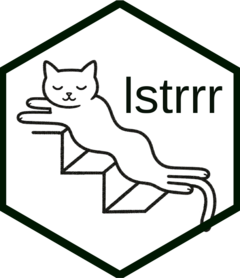

<!-- README.md is generated from README.Rmd. Please edit that file -->

```{r}
#| include = FALSE
knitr::opts_chunk$set(
  collapse = TRUE,
  comment = "#>",
  fig.path = "man/figures/README-",
  out.width = "100%"
)
devtools::load_all()
```

# lstrrr  <a href="https://exceret.github.io/lstrrr/"></a>

<!-- badges: start -->
[](https://lifecycle.r-lib.org/articles/stages.html#stable)
[](https://CRAN.R-project.org/package=lstrrr)
[](https://github.com/Exceret/lstrrr)
[](https://github.com/Exceret/lstrrr/actions/workflows/R-CMD-check.yaml)
[](https://app.codecov.io/gh/Exceret/lstrrr)
[](https://cran.r-project.org/package=lstrrr)

<!-- badges: end -->

lstrrr provides functional programming tools for working with deeply nested R lists — path-based access, recursive mapping/walking, conditional modification, and structure visualization. Motivation comes from [purrr](https://github.com/tidyverse/purrr)

purrr can handle with R list, but it converts R list in to a vector or atomic, which is not what we want. lstrrr is designed to work with R list and return the same list structure.

## Installation

``` r
# install.packages("pak")
pak::pak("Exceret/lstrrr")
```

## Agent Skill

`lstrrr` also ships an agent skill that summarizes every exported function and
the workflow for choosing one. It first checks whether the object is really a
complex nested list and falls back to `purrr` or `base::lapply()` otherwise.

``` bash
npx skills add Exceret/lstrrr
```

## Getting Started

Use it just like `purrr`

```{r}
#| label = "example"
library(lstrrr)

x <- list(
  a = 1,
  b = list(x = 2, y = list(i = 3, j = 4))
)

# Path-based access
list_get(x, c("b", "y", "i"))

# Recursive mapping
list_map(x, ~ .x * 2) |> str()

# Flatten with path names
list_flatten(x) |> str()

# Conditional modification (only values > 2)
list_modify_if(x, ~ is.numeric(.x) && .x > 2, ~ .x * 10) |> str()

# Tree visualization (requires ggplot2)
# viz_list(x)
```

## Similar Projects

A similar project is [rlist](https://github.com/renkun-ken/rlist), but it is not for complex nested list.

Let's see how they work differently. This is a code snippet from rlist:

```{r}
#| label = "comparison_with_rlist"
nums <- list(a = c(1, 2, 3), b = c(2, 3, 4), c = c(3, 4, 5))

rlist::list.map(nums, c(min = min(.), max = max(.))) |> str()
rlist::list.filter(nums, x ~ mean(x) >= 3) |> str()
rlist::list.map(nums, f(x, i) ~ sum(x, i)) |> str()
```

If `nums` becomes a complex nested list, rlist may not work as expected.

```{r}
#| label = "comparison_with_rlist_complex"
nums <- list(
  a = c(1, 2, 3),
  b = c(2, 3, 4),
  c = c(3, 4, 5),
  d = list(
    e = c(4, 5, 6),
    f = c(5, 6, 7)
  )
)

try(rlist::list.map(nums, c(min = min(.), max = max(.))))
try(rlist::list.filter(nums, x ~ mean(x) >= 3))
try(rlist::list.map(nums, f(x, i) ~ sum(x, i)))
```

**Recursive mapping is the main difference between lstrrr and rlist**. lstrrr views the list as a tree, and recursively applies the function to leaf nodes. 

```{r}
#| label = "comparison_with_lstrrr"
list_map(nums, \(v) c(min = min(v), max = max(v))) |> str()
list_find(nums, ~ mean(.x) >= 3) |> str()
list_map(nums, sum) |> str()
```

---

Another similar project is [rrapply](https://github.com/JorisChau/rrapply/), which also provide list recursion in R.

```{r}
#| label = "comparison_with_rrapply"
dat <- list(
  user = list(
    name = "alice",
    age = 20,
    scores = list(
      math = 80,
      english = 90
    )
  ),
  status = "active"
)
```

```{r}
#| label = "comparison_with_rrapply_example"
result1 <- rrapply::rrapply(
  dat,
  f = function(x) x + 5,
  classes = "numeric",
  condition = function(x) x >= 80
)
str(result1)
```

```{r}
#| label = "comparison_with_lstrrr_example"
result2 <- list_modify_if(dat, ~ is.numeric(.x) & .x >= 80, ~ .x + 5)
str(result2)
```

The differences between `lstrrr` and `rrapply` are as follows:

1. `lstrrr` follows the design philosophy of [purrr](https://github.com/tidyverse/purrr), whereas `rrapply` is based on base R’s `rapply()`.
2. `lstrrr` provides a native progress bar similar to the one in purrr (using [cli](https://github.com/r-lib/cli) C API).
3. `lstrrr` provides several basic functions for working with nested lists, such as `list_set()`, `list_get()`, and `list_nleaf()`.

---

To see more examples, click [here](https://exceret.github.io/lstrrr/index.html)
