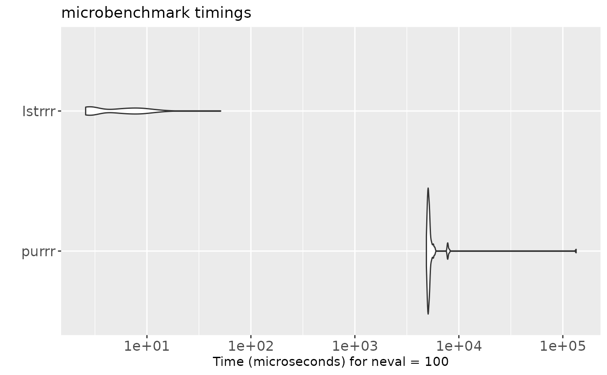

# Performance Benchmarking

``` r

library(lstrrr)
#> ✔ lstrrr v0.1.1 loaded
data(sputnik_1)
```

## Map & Walk

Here, we will use a simple example to illustrate the performance
difference of `lstrrr`.

``` r

files <- list.files(all.files = TRUE, recursive = TRUE)
files_list <- dir_listwise(files)
```

``` r

slow_string_op <- function(x, n = 10) {
  stopifnot(is.character(x))

  out <- x

  for (i in seq_len(n)) {
    out <- paste0(
      rev(strsplit(out, "", fixed = TRUE)[[1]]),
      collapse = ""
    )
    out <- toupper(out)
    out <- tolower(out)
  }

  out
}

set.seed(123)

bench_map <- microbenchmark::microbenchmark(
  purrr_10 = {
    purrr::walk(files, \(x) slow_string_op(x))
  },
  lstrrr_10 = {
    list_walk(files_list, \(x) slow_string_op(x))
  },
  rrapply_10 = {
    rrapply::rrapply(files_list, f = \(x) slow_string_op(x))
  },
  purrr_50 = {
    purrr::walk(files, \(x) slow_string_op(x, n = 50))
  },
  lstrrr_50 = {
    list_walk(files_list, \(x) slow_string_op(x, n = 50))
  },
  rrapply_50 = {
    rrapply::rrapply(files_list, f = \(x) slow_string_op(x, n = 50))
  }
  # ,
  # purrr_100 = {
  #   purrr::walk(files, \(x) slow_string_op(x, n = 100))
  # },
  # lstrrr_100 = {
  #   list_walk(files_list, \(x) slow_string_op(x, n = 100))
  # },
  # rrapply_100 = {
  #   rrapply::rrapply(files_list, f = \(x) slow_string_op(x, n = 100))
  # }
)
print(bench_map)
#> Unit: milliseconds
#>        expr       min        lq      mean    median        uq      max neval
#>    purrr_10  3.615778  3.706007  4.726053  3.756296  3.806342 61.40171   100
#>   lstrrr_10  3.529089  3.635877  3.989060  3.676284  3.716994  9.00946   100
#>  rrapply_10  3.590120  3.682322  3.950555  3.739477  3.785840 13.84159   100
#>    purrr_50 17.239350 17.682814 18.483424 17.868550 18.007398 32.69678   100
#>   lstrrr_50 17.329775 17.686205 18.905134 17.840725 18.186308 24.78150   100
#>  rrapply_50 17.108436 17.723896 18.865973 17.894264 18.224511 23.06341   100
```

``` r

ggplot2::autoplot(bench_map) +
  ggplot2::theme(axis.text = ggplot2::element_text(size = 12))
#> Warning: `aes_string()` was deprecated in ggplot2 3.0.0.
#> ℹ Please use tidy evaluation idioms with `aes()`.
#> ℹ See also `vignette("ggplot2-in-packages")` for more information.
#> ℹ The deprecated feature was likely used in the microbenchmark package.
#>   Please report the issue at
#>   <https://github.com/joshuaulrich/microbenchmark/issues/>.
#> This warning is displayed once per session.
#> Call `lifecycle::last_lifecycle_warnings()` to see where this warning was
#> generated.
```


## Detect Depth

``` r

set.seed(124)

bench_depth <- microbenchmark::microbenchmark(
  purrr = {
    purrr::pluck_depth(sputnik_1)
  },
  lstrrr = {
    list_depth(sputnik_1)
  }
)
print(bench_depth)
#> Unit: microseconds
#>    expr      min        lq       mean   median        uq        max neval
#>   purrr 4871.576 5037.2565 6616.32380 5117.737 5260.1480 134304.604   100
#>  lstrrr    2.574    2.8045    6.12085    5.208    8.2675     51.227   100
```

``` r

ggplot2::autoplot(bench_depth) +
  ggplot2::theme(axis.text = ggplot2::element_text(size = 12))
```



## Assignment

``` r

set.seed(125)

bench_assign <- microbenchmark::microbenchmark(
  purrr = {
    purrr::list_assign(sputnik_1, z = list(a = 1:5))
  },
  lstrrr = {
    list_set(sputnik_1, c("z"), list(a = 1:5))
  }
)
print(bench_assign)
#> Unit: microseconds
#>    expr    min      lq     mean  median     uq     max neval
#>   purrr 18.928 19.6145 24.32557 19.9245 20.400 413.725   100
#>  lstrrr  1.883  2.0130  2.41702  2.1280  2.318  23.465   100
```

``` r

ggplot2::autoplot(bench_assign) +
  ggplot2::theme(axis.text = ggplot2::element_text(size = 12))
```


## Modification

``` r

set.seed(126)

bench_modify <- microbenchmark::microbenchmark(
  purrr = {
    purrr::list_modify(sputnik_1, test_branches = list(null_leaf = 1:5))
  },
  lstrrr = {
    list_set(sputnik_1, c("test_branches", "null_leaf"), 1:5)
  }
)
print(bench_modify)
#> Unit: microseconds
#>    expr    min      lq     mean median      uq     max neval
#>   purrr 33.059 33.9605 36.89905 34.401 35.0670 215.040   100
#>  lstrrr  1.783  1.9475  2.40706  2.023  2.2035  22.844   100
```

``` r

ggplot2::autoplot(bench_modify) +
  ggplot2::theme(axis.text = ggplot2::element_text(size = 12))
```


## Modification Under Condition

``` r

set.seed(1260)

bench_modify_cond <- microbenchmark::microbenchmark(
  rrapply = {
    rrapply::rrapply(
      sputnik_1,
      f = function(x) x**2,
      classes = "numeric",
      condition = function(x) x >= 10
    )
  },
  lstrrr = {
    list_modify_if(sputnik_1, function(x) is.numeric(x) & x >= 10, function(x) {
      x**2
    })
  }
)
print(bench_modify_cond)
#> Unit: microseconds
#>     expr      min       lq       mean   median        uq      max neval
#>  rrapply   48.663   55.663   77.31749   60.405   64.1105 1708.572   100
#>   lstrrr 1160.967 1187.045 1261.49270 1202.164 1224.2460 4062.682   100
```

``` r

ggplot2::autoplot(bench_modify_cond) +
  ggplot2::theme(axis.text = ggplot2::element_text(size = 12))
```


## Flatten

``` r

set.seed(127)

bench_flatten <- microbenchmark::microbenchmark(
  purrr = {
    purrr::list_flatten(sputnik_1)
  },
  lstrrr = {
    list_flatten(sputnik_1)
  },
  rrapply = {
    rrapply::rrapply(sputnik_1, how = "flatten")
  }
)
print(bench_flatten)
#> Unit: microseconds
#>     expr      min        lq       mean    median       uq      max neval
#>    purrr 1112.014 1164.7375 1254.34382 1201.0410 1245.007 4273.135   100
#>   lstrrr   32.598   36.4495   42.39311   41.4265   45.873  104.035   100
#>  rrapply   33.079   38.2570   44.63407   43.6300   49.053   94.690   100
```

``` r

ggplot2::autoplot(bench_flatten) +
  ggplot2::theme(axis.text = ggplot2::element_text(size = 12))
```


## modifyList

``` r

set.seed(128)

foo <- sputnik_1
foo$test_branches$empty_branch$score <- 1e-256

bench_modify_list <- microbenchmark::microbenchmark(
  utils = {
    utils::modifyList(sputnik_1, foo)
  },
  lstrrr = {
    modify_list(sputnik_1, foo)
  }
)
print(bench_modify_list)
#> Unit: microseconds
#>    expr     min       lq      mean   median       uq      max neval
#>   utils 747.482 764.9325 816.15411 777.3610 799.5745 3544.722   100
#>  lstrrr  16.174  17.0410  19.54068  18.5575  19.4990   94.551   100
```

``` r

ggplot2::autoplot(bench_modify_list) +
  ggplot2::theme(axis.text = ggplot2::element_text(size = 12))
```


## Parallel Computation

Most of logic is in C implementation, so the acceleration is not that
obvious.

``` r

set.seed(129)
mirai::daemons(3L)
crate <- purrr::in_parallel(
  \(x) {
    slow_string_op(x, n = 10)
  },
  slow_string_op = slow_string_op
)
fn <- function(x) {
  slow_string_op(x, n = 10)
}

bench_parallel <- microbenchmark::microbenchmark(
  lstrrr_parallel = {
    list_map(files_list, crate)
  },
  lstrrr = {
    list_map(files_list, fn)
  },
  purrr = {
    purrr::map(files, fn)
  },
  purrr_parallel = {
    purrr::map(files, crate)
  }
)
mirai::daemons(0L)
print(bench_parallel)
#> Unit: milliseconds
#>             expr      min       lq     mean   median       uq       max neval
#>  lstrrr_parallel 3.672142 3.753348 3.824367 3.807904 3.854012  4.563527   100
#>           lstrrr 3.460006 3.557291 3.870903 3.605533 3.660800 12.262208   100
#>            purrr 3.497743 3.634986 4.002638 3.677726 3.761004 11.997864   100
#>   purrr_parallel 8.182746 9.018689 9.496059 9.163802 9.496289 16.325211   100
```

``` r

ggplot2::autoplot(bench_parallel) +
  ggplot2::theme(axis.text = ggplot2::element_text(size = 12))
```


