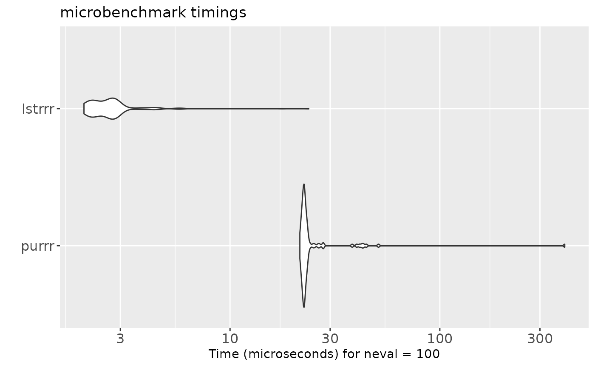

# Performance Benchmarking

``` r

library(lstrrr)
#> ✔ lstrrr v0.1.2 loaded
data(sputnik_1)
```

## Map & Walk

Here, we will use a simple example to illustrate the performance
difference of `lstrrr`.

``` r

files <- list.files(all.files = TRUE, recursive = TRUE)
files_list <- dir_listwise(files)
```

``` r

slow_string_op <- function(x, n = 10) {
  stopifnot(is.character(x))

  out <- x

  for (i in seq_len(n)) {
    out <- paste0(
      rev(strsplit(out, "", fixed = TRUE)[[1]]),
      collapse = ""
    )
    out <- toupper(out)
    out <- tolower(out)
  }

  out
}

set.seed(123)

bench_map <- microbenchmark::microbenchmark(
  purrr_10 = {
    purrr::walk(files, \(x) slow_string_op(x))
  },
  lstrrr_10 = {
    list_walk(files_list, \(x) slow_string_op(x))
  },
  rrapply_10 = {
    rrapply::rrapply(files_list, f = \(x) slow_string_op(x))
  },
  purrr_50 = {
    purrr::walk(files, \(x) slow_string_op(x, n = 50))
  },
  lstrrr_50 = {
    list_walk(files_list, \(x) slow_string_op(x, n = 50))
  },
  rrapply_50 = {
    rrapply::rrapply(files_list, f = \(x) slow_string_op(x, n = 50))
  }
  # ,
  # purrr_100 = {
  #   purrr::walk(files, \(x) slow_string_op(x, n = 100))
  # },
  # lstrrr_100 = {
  #   list_walk(files_list, \(x) slow_string_op(x, n = 100))
  # },
  # rrapply_100 = {
  #   rrapply::rrapply(files_list, f = \(x) slow_string_op(x, n = 100))
  # }
)
print(bench_map)
#> Unit: milliseconds
#>        expr       min        lq      mean    median        uq       max neval
#>    purrr_10  3.961083  4.033694  4.823454  4.066194  4.115768 60.486260   100
#>   lstrrr_10  3.897655  3.948560  4.162315  3.976172  4.007770  8.602387   100
#>  rrapply_10  3.909938  3.976648  4.206503  4.012800  4.050660 13.957162   100
#>    purrr_50 18.909675 19.276752 20.483770 19.386051 20.133911 32.911762   100
#>   lstrrr_50 18.838733 19.169040 20.078482 19.279677 19.549740 23.931559   100
#>  rrapply_50 18.929713 19.109810 20.038891 19.266593 19.434596 24.077311   100
```

``` r

ggplot2::autoplot(bench_map) +
  ggplot2::theme(axis.text = ggplot2::element_text(size = 12))
#> Warning: `aes_string()` was deprecated in ggplot2 3.0.0.
#> ℹ Please use tidy evaluation idioms with `aes()`.
#> ℹ See also `vignette("ggplot2-in-packages")` for more information.
#> ℹ The deprecated feature was likely used in the microbenchmark package.
#>   Please report the issue at
#>   <https://github.com/joshuaulrich/microbenchmark/issues/>.
#> This warning is displayed once per session.
#> Call `lifecycle::last_lifecycle_warnings()` to see where this warning was
#> generated.
```


## Detect Depth

``` r

set.seed(124)

bench_depth <- microbenchmark::microbenchmark(
  purrr = {
    purrr::pluck_depth(sputnik_1)
  },
  lstrrr = {
    list_depth(sputnik_1)
  }
)
print(bench_depth)
#> Unit: microseconds
#>    expr      min        lq       mean    median        uq        max neval
#>   purrr 5744.182 5830.5435 7153.51225 5940.8395 6106.0325 110306.532   100
#>  lstrrr    2.455    2.9155    5.52095    4.9745    6.6925     36.638   100
```

``` r

ggplot2::autoplot(bench_depth) +
  ggplot2::theme(axis.text = ggplot2::element_text(size = 12))
```


## Assignment

``` r

set.seed(125)

bench_assign <- microbenchmark::microbenchmark(
  purrr = {
    purrr::list_assign(sputnik_1, z = list(a = 1:5))
  },
  lstrrr = {
    list_set(sputnik_1, c("z"), list(a = 1:5))
  }
)
print(bench_assign)
#> Unit: microseconds
#>    expr    min     lq     mean median     uq     max neval
#>   purrr 21.521 22.247 27.92821 22.612 23.183 393.845   100
#>  lstrrr  2.013  2.254  3.04692  2.624  2.870  23.724   100
```

``` r

ggplot2::autoplot(bench_assign) +
  ggplot2::theme(axis.text = ggplot2::element_text(size = 12))
```



## Modification

``` r

set.seed(126)

bench_modify <- microbenchmark::microbenchmark(
  purrr = {
    purrr::list_modify(sputnik_1, test_branches = list(null_leaf = 1:5))
  },
  lstrrr = {
    list_set(sputnik_1, c("test_branches", "null_leaf"), 1:5)
  }
)
print(bench_modify)
#> Unit: microseconds
#>    expr    min     lq     mean  median     uq     max neval
#>   purrr 37.430 38.662 41.93702 39.2480 39.899 205.494   100
#>  lstrrr  1.803  2.014  2.58920  2.4395  2.630  20.869   100
```

``` r

ggplot2::autoplot(bench_modify) +
  ggplot2::theme(axis.text = ggplot2::element_text(size = 12))
```


## Modification Under Condition

``` r

set.seed(1260)

bench_modify_cond <- microbenchmark::microbenchmark(
  rrapply = {
    rrapply::rrapply(
      sputnik_1,
      f = function(x) x**2,
      classes = "numeric",
      condition = function(x) x >= 10
    )
  },
  lstrrr = {
    list_modify_if(sputnik_1, function(x) is.numeric(x) & x >= 10, function(x) {
      x**2
    })
  }
)
print(bench_modify_cond)
#> Unit: microseconds
#>     expr      min        lq       mean    median       uq      max neval
#>  rrapply   54.642   59.9115   83.73573   66.1685   70.131 1805.931   100
#>   lstrrr 1298.975 1328.2295 1408.66890 1345.0605 1368.144 4313.782   100
```

``` r

ggplot2::autoplot(bench_modify_cond) +
  ggplot2::theme(axis.text = ggplot2::element_text(size = 12))
```


## Flatten

``` r

set.seed(127)

bench_flatten <- microbenchmark::microbenchmark(
  purrr = {
    purrr::list_flatten(sputnik_1)
  },
  lstrrr = {
    list_flatten(sputnik_1)
  },
  rrapply = {
    rrapply::rrapply(sputnik_1, how = "flatten")
  }
)
print(bench_flatten)
#> Unit: microseconds
#>     expr      min       lq       mean    median        uq      max neval
#>    purrr 1370.138 1436.611 1514.16226 1473.0395 1509.2670 4390.104   100
#>   lstrrr   32.641   37.084   41.62661   40.8165   43.9470   95.037   100
#>  rrapply   36.047   41.418   49.36995   46.4370   53.5055   89.768   100
```

``` r

ggplot2::autoplot(bench_flatten) +
  ggplot2::theme(axis.text = ggplot2::element_text(size = 12))
```


## modifyList

``` r

set.seed(128)

foo <- sputnik_1
foo$test_branches$empty_branch$score <- 1e-256

bench_modify_list <- microbenchmark::microbenchmark(
  utils = {
    utils::modifyList(sputnik_1, foo)
  },
  lstrrr = {
    modify_list(sputnik_1, foo)
  }
)
print(bench_modify_list)
#> Unit: microseconds
#>    expr     min       lq      mean  median      uq      max neval
#>   utils 781.949 801.2355 848.52838 811.019 833.390 3369.198   100
#>  lstrrr  16.320  17.1520  19.32133  18.500  19.872   75.772   100
```

``` r

ggplot2::autoplot(bench_modify_list) +
  ggplot2::theme(axis.text = ggplot2::element_text(size = 12))
```


## Parallel Computation

Most of logic is in C implementation, so the acceleration is not that
obvious.

``` r

set.seed(129)
mirai::daemons(3L)
crate <- purrr::in_parallel(
  \(x) {
    slow_string_op(x, n = 10)
  },
  slow_string_op = slow_string_op
)
fn <- function(x) {
  slow_string_op(x, n = 10)
}

bench_parallel <- microbenchmark::microbenchmark(
  lstrrr_parallel = {
    list_map(files_list, crate)
  },
  lstrrr = {
    list_map(files_list, fn)
  },
  purrr = {
    purrr::map(files, fn)
  },
  purrr_parallel = {
    purrr::map(files, crate)
  }
)
mirai::daemons(0L)
print(bench_parallel)
#> Unit: milliseconds
#>             expr      min       lq      mean    median        uq      max neval
#>  lstrrr_parallel 4.077511 4.160681  4.282870  4.194049  4.252477 10.96350   100
#>           lstrrr 3.908366 3.966133  4.261715  4.006574  4.057463 12.63510   100
#>            purrr 3.988826 4.042521  4.322872  4.088862  4.153748 11.39828   100
#>   purrr_parallel 9.314729 9.805423 10.386484 10.132081 10.539089 17.15118   100
```

``` r

ggplot2::autoplot(bench_parallel) +
  ggplot2::theme(axis.text = ggplot2::element_text(size = 12))
```


