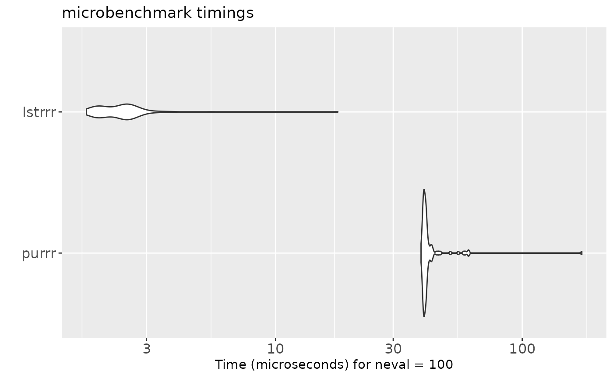
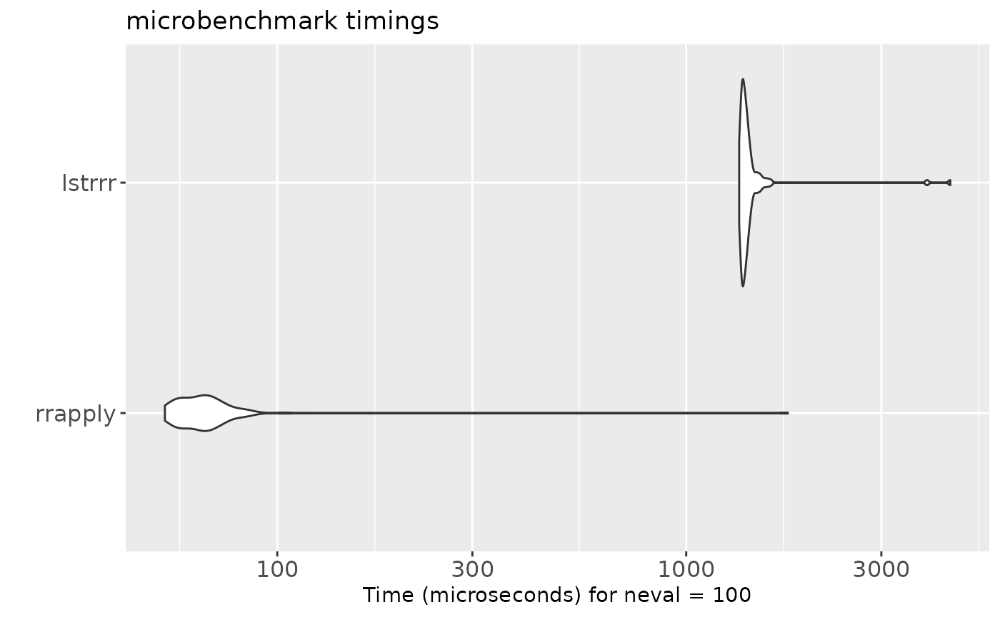
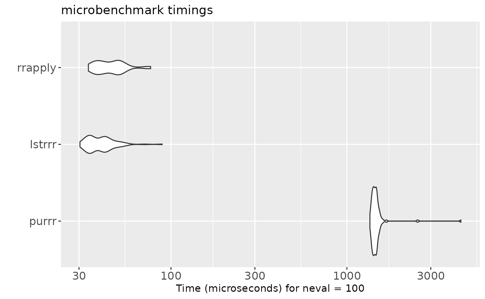
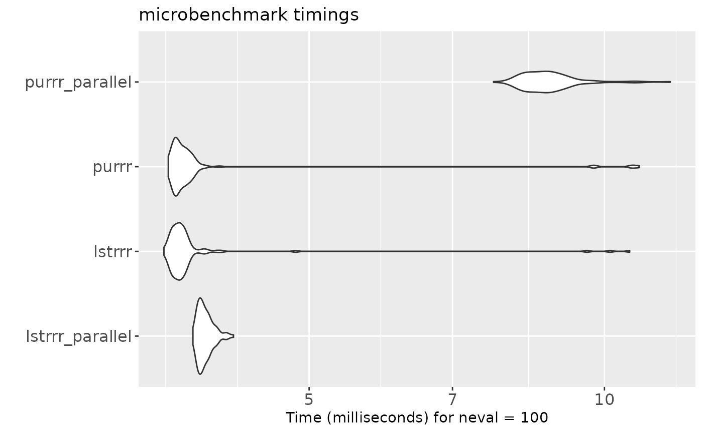

# Performance Benchmarking

``` r

library(lstrrr)
#> ✔ lstrrr v0.1.2 loaded
data(sputnik_1)
```

## Map & Walk

Here, we will use a simple example to illustrate the performance
difference of `lstrrr`.

``` r

files <- list.files(all.files = TRUE, recursive = TRUE)
files_list <- dir_listwise(files)
```

``` r

slow_string_op <- function(x, n = 10) {
  stopifnot(is.character(x))

  out <- x

  for (i in seq_len(n)) {
    out <- paste0(
      rev(strsplit(out, "", fixed = TRUE)[[1]]),
      collapse = ""
    )
    out <- toupper(out)
    out <- tolower(out)
  }

  out
}

set.seed(123)

bench_map <- microbenchmark::microbenchmark(
  purrr_10 = {
    purrr::walk(files, \(x) slow_string_op(x))
  },
  lstrrr_10 = {
    list_walk(files_list, \(x) slow_string_op(x))
  },
  rrapply_10 = {
    rrapply::rrapply(files_list, f = \(x) slow_string_op(x))
  },
  purrr_50 = {
    purrr::walk(files, \(x) slow_string_op(x, n = 50))
  },
  lstrrr_50 = {
    list_walk(files_list, \(x) slow_string_op(x, n = 50))
  },
  rrapply_50 = {
    rrapply::rrapply(files_list, f = \(x) slow_string_op(x, n = 50))
  }
  # ,
  # purrr_100 = {
  #   purrr::walk(files, \(x) slow_string_op(x, n = 100))
  # },
  # lstrrr_100 = {
  #   list_walk(files_list, \(x) slow_string_op(x, n = 100))
  # },
  # rrapply_100 = {
  #   rrapply::rrapply(files_list, f = \(x) slow_string_op(x, n = 100))
  # }
)
print(bench_map)
#> Unit: milliseconds
#>        expr       min        lq      mean    median        uq       max neval
#>    purrr_10  3.561682  3.628608  4.413449  3.652592  3.702114 57.449430   100
#>   lstrrr_10  3.519384  3.583974  3.816000  3.620387  3.687742  7.857033   100
#>  rrapply_10  3.546734  3.602288  3.801349  3.635174  3.667185 12.037048   100
#>    purrr_50 17.042032 17.349450 18.636048 17.537066 19.741552 30.989985   100
#>   lstrrr_50 17.135086 17.328722 18.308015 17.555225 17.985962 23.175791   100
#>  rrapply_50 16.913694 17.235483 18.113656 17.369529 17.636250 25.467536   100
```

``` r

ggplot2::autoplot(bench_map) +
  ggplot2::theme(axis.text = ggplot2::element_text(size = 12))
#> Warning: `aes_string()` was deprecated in ggplot2 3.0.0.
#> ℹ Please use tidy evaluation idioms with `aes()`.
#> ℹ See also `vignette("ggplot2-in-packages")` for more information.
#> ℹ The deprecated feature was likely used in the microbenchmark package.
#>   Please report the issue at
#>   <https://github.com/joshuaulrich/microbenchmark/issues/>.
#> This warning is displayed once per session.
#> Call `lifecycle::last_lifecycle_warnings()` to see where this warning was
#> generated.
```


## Detect Depth

``` r

set.seed(124)

bench_depth <- microbenchmark::microbenchmark(
  purrr = {
    purrr::pluck_depth(sputnik_1)
  },
  lstrrr = {
    list_depth(sputnik_1)
  }
)
print(bench_depth)
#> Unit: microseconds
#>    expr      min        lq       mean   median       uq        max neval
#>   purrr 5671.888 5781.6620 7097.40574 5884.074 6057.437 104071.047   100
#>  lstrrr    2.314    2.7905    5.07638    4.699    5.575     49.192   100
```

``` r

ggplot2::autoplot(bench_depth) +
  ggplot2::theme(axis.text = ggplot2::element_text(size = 12))
```


## Assignment

``` r

set.seed(125)

bench_assign <- microbenchmark::microbenchmark(
  purrr = {
    purrr::list_assign(sputnik_1, z = list(a = 1:5))
  },
  lstrrr = {
    list_set(sputnik_1, c("z"), list(a = 1:5))
  }
)
print(bench_assign)
#> Unit: microseconds
#>    expr    min     lq     mean median     uq     max neval
#>   purrr 22.181 22.993 27.65281 23.349 23.970 345.184   100
#>  lstrrr  1.833  2.059  2.61589  2.385  2.696  17.433   100
```

``` r

ggplot2::autoplot(bench_assign) +
  ggplot2::theme(axis.text = ggplot2::element_text(size = 12))
```


## Modification

``` r

set.seed(126)

bench_modify <- microbenchmark::microbenchmark(
  purrr = {
    purrr::list_modify(sputnik_1, test_branches = list(null_leaf = 1:5))
  },
  lstrrr = {
    list_set(sputnik_1, c("test_branches", "null_leaf"), 1:5)
  }
)
print(bench_modify)
#> Unit: microseconds
#>    expr    min     lq     mean median      uq     max neval
#>   purrr 38.882 39.839 42.96973 40.411 41.1670 174.395   100
#>  lstrrr  1.713  1.964  2.51346  2.394  2.5995  17.893   100
```

``` r

ggplot2::autoplot(bench_modify) +
  ggplot2::theme(axis.text = ggplot2::element_text(size = 12))
```



## Modification Under Condition

``` r

set.seed(1260)

bench_modify_cond <- microbenchmark::microbenchmark(
  rrapply = {
    rrapply::rrapply(
      sputnik_1,
      f = function(x) x**2,
      classes = "numeric",
      condition = function(x) x >= 10
    )
  },
  lstrrr = {
    list_modify_if(sputnik_1, function(x) is.numeric(x) & x >= 10, function(x) {
      x**2
    })
  }
)
print(bench_modify_cond)
#> Unit: microseconds
#>     expr      min        lq       mean    median       uq      max neval
#>  rrapply   53.119   58.6195   82.80477   65.0565   70.591 1772.195   100
#>   lstrrr 1347.563 1369.5790 1459.20158 1391.6155 1421.657 4422.929   100
```

``` r

ggplot2::autoplot(bench_modify_cond) +
  ggplot2::theme(axis.text = ggplot2::element_text(size = 12))
```



## Flatten

``` r

set.seed(127)

bench_flatten <- microbenchmark::microbenchmark(
  purrr = {
    purrr::list_flatten(sputnik_1)
  },
  lstrrr = {
    list_flatten(sputnik_1)
  },
  rrapply = {
    rrapply::rrapply(sputnik_1, how = "flatten")
  }
)
print(bench_flatten)
#> Unit: microseconds
#>     expr      min        lq       mean    median        uq      max neval
#>    purrr 1352.262 1407.5500 1489.37672 1443.7975 1478.2420 4448.948   100
#>   lstrrr   30.386   34.8505   40.52652   40.2105   43.3910   89.206   100
#>  rrapply   33.923   38.5820   46.15337   44.9440   50.9905   76.632   100
```

``` r

ggplot2::autoplot(bench_flatten) +
  ggplot2::theme(axis.text = ggplot2::element_text(size = 12))
```



## modifyList

``` r

set.seed(128)

foo <- sputnik_1
foo$test_branches$empty_branch$score <- 1e-256

bench_modify_list <- microbenchmark::microbenchmark(
  utils = {
    utils::modifyList(sputnik_1, foo)
  },
  lstrrr = {
    modify_list(sputnik_1, foo)
  }
)
print(bench_modify_list)
#> Unit: microseconds
#>    expr     min      lq      mean   median      uq      max neval
#>   utils 784.233 807.100 857.10916 822.5940 842.191 3382.128   100
#>  lstrrr  15.840  16.591  19.14323  18.4195  19.291   64.480   100
```

``` r

ggplot2::autoplot(bench_modify_list) +
  ggplot2::theme(axis.text = ggplot2::element_text(size = 12))
```


## Parallel Computation

Most of logic is in C implementation, so the acceleration is not that
obvious.

``` r

set.seed(129)
mirai::daemons(3L)
crate <- purrr::in_parallel(
  \(x) {
    slow_string_op(x, n = 10)
  },
  slow_string_op = slow_string_op
)
fn <- function(x) {
  slow_string_op(x, n = 10)
}

bench_parallel <- microbenchmark::microbenchmark(
  lstrrr_parallel = {
    list_map(files_list, crate)
  },
  lstrrr = {
    list_map(files_list, fn)
  },
  purrr = {
    purrr::map(files, fn)
  },
  purrr_parallel = {
    purrr::map(files, crate)
  }
)
mirai::daemons(0L)
print(bench_parallel)
#> Unit: milliseconds
#>             expr      min       lq     mean   median       uq       max neval
#>  lstrrr_parallel 3.806479 3.861096 3.917988 3.898701 3.951804  4.186808   100
#>           lstrrr 3.556082 3.637138 3.901227 3.687106 3.738613 10.611119   100
#>            purrr 3.592590 3.651039 4.039310 3.696749 3.773747 10.850666   100
#>   purrr_parallel 7.707791 8.357838 8.789072 8.705645 8.989425 11.673048   100
```

``` r

ggplot2::autoplot(bench_parallel) +
  ggplot2::theme(axis.text = ggplot2::element_text(size = 12))
```


