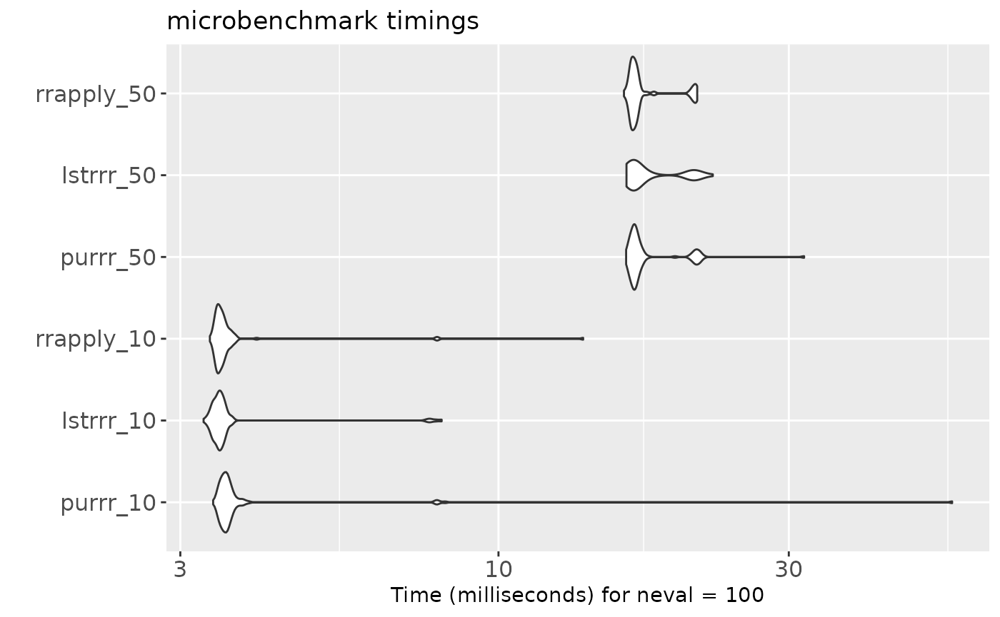

# Performance Benchmarking

``` r

library(lstrrr)
#> ✔ lstrrr v0.1.1 loaded
data(sputnik_1)
```

## Map & Walk

Here, we will use a simple example to illustrate the performance
difference of `lstrrr`.

``` r

files <- list.files(all.files = TRUE, recursive = TRUE)
files_list <- dir_listwise(files)
```

``` r

slow_string_op <- function(x, n = 10) {
  stopifnot(is.character(x))

  out <- x

  for (i in seq_len(n)) {
    out <- paste0(
      rev(strsplit(out, "", fixed = TRUE)[[1]]),
      collapse = ""
    )
    out <- toupper(out)
    out <- tolower(out)
  }

  out
}

set.seed(123)

bench_map <- microbenchmark::microbenchmark(
  purrr_10 = {
    purrr::walk(files, \(x) slow_string_op(x))
  },
  lstrrr_10 = {
    list_walk(files_list, \(x) slow_string_op(x))
  },
  rrapply_10 = {
    rrapply::rrapply(files_list, f = \(x) slow_string_op(x))
  },
  purrr_50 = {
    purrr::walk(files, \(x) slow_string_op(x, n = 50))
  },
  lstrrr_50 = {
    list_walk(files_list, \(x) slow_string_op(x, n = 50))
  },
  rrapply_50 = {
    rrapply::rrapply(files_list, f = \(x) slow_string_op(x, n = 50))
  }
  # ,
  # purrr_100 = {
  #   purrr::walk(files, \(x) slow_string_op(x, n = 100))
  # },
  # lstrrr_100 = {
  #   list_walk(files_list, \(x) slow_string_op(x, n = 100))
  # },
  # rrapply_100 = {
  #   rrapply::rrapply(files_list, f = \(x) slow_string_op(x, n = 100))
  # }
)
print(bench_map)
#> Unit: milliseconds
#>        expr       min        lq      mean    median        uq       max neval
#>    purrr_10  3.396660  3.510921  4.269204  3.569643  3.623290 55.662388   100
#>   lstrrr_10  3.275929  3.415773  3.688789  3.479704  3.536048  8.065744   100
#>  rrapply_10  3.355032  3.449495  3.699955  3.498810  3.555878 13.777914   100
#>    purrr_50 16.209842 16.599302 17.679137 16.817613 17.203496 31.792955   100
#>   lstrrr_50 16.231979 16.551567 17.820770 16.809843 19.223696 22.504810   100
#>  rrapply_50 16.077934 16.538009 17.356442 16.741030 16.989609 21.214106   100
```

``` r

ggplot2::autoplot(bench_map) +
  ggplot2::theme(axis.text = ggplot2::element_text(size = 12))
#> Warning: `aes_string()` was deprecated in ggplot2 3.0.0.
#> ℹ Please use tidy evaluation idioms with `aes()`.
#> ℹ See also `vignette("ggplot2-in-packages")` for more information.
#> ℹ The deprecated feature was likely used in the microbenchmark package.
#>   Please report the issue at
#>   <https://github.com/joshuaulrich/microbenchmark/issues/>.
#> This warning is displayed once per session.
#> Call `lifecycle::last_lifecycle_warnings()` to see where this warning was
#> generated.
```



## Detect Depth

``` r

set.seed(124)

bench_depth <- microbenchmark::microbenchmark(
  purrr = {
    purrr::pluck_depth(sputnik_1)
  },
  lstrrr = {
    list_depth(sputnik_1)
  }
)
print(bench_depth)
#> Unit: microseconds
#>    expr      min       lq       mean   median       uq        max neval
#>   purrr 4313.423 4533.283 6150.12162 4762.137 4924.936 134416.229   100
#>  lstrrr    2.200    2.503    5.59608    5.577    7.167     51.844   100
```

``` r

ggplot2::autoplot(bench_depth) +
  ggplot2::theme(axis.text = ggplot2::element_text(size = 12))
```


## Assignment

``` r

set.seed(125)

bench_assign <- microbenchmark::microbenchmark(
  purrr = {
    purrr::list_assign(sputnik_1, z = list(a = 1:5))
  },
  lstrrr = {
    list_set(sputnik_1, c("z"), list(a = 1:5))
  }
)
print(bench_assign)
#> Unit: microseconds
#>    expr    min     lq     mean median     uq     max neval
#>   purrr 16.437 17.318 21.44886 17.649 18.054 367.086   100
#>  lstrrr  1.678  1.796  2.22464  1.911  2.062  18.359   100
```

``` r

ggplot2::autoplot(bench_assign) +
  ggplot2::theme(axis.text = ggplot2::element_text(size = 12))
```


## Modification

``` r

set.seed(126)

bench_modify <- microbenchmark::microbenchmark(
  purrr = {
    purrr::list_modify(sputnik_1, test_branches = list(null_leaf = 1:5))
  },
  lstrrr = {
    list_set(sputnik_1, c("test_branches", "null_leaf"), 1:5)
  }
)
print(bench_modify)
#> Unit: microseconds
#>    expr    min     lq     mean  median     uq     max neval
#>   purrr 29.025 29.460 32.53411 30.0630 31.382 181.425   100
#>  lstrrr  1.480  1.623  1.89086  1.6925  1.807  16.051   100
```

``` r

ggplot2::autoplot(bench_modify) +
  ggplot2::theme(axis.text = ggplot2::element_text(size = 12))
```


## Modification Under Condition

``` r

set.seed(1260)

bench_modify_cond <- microbenchmark::microbenchmark(
  rrapply = {
    rrapply::rrapply(
      sputnik_1,
      f = function(x) x**2,
      classes = "numeric",
      condition = function(x) x >= 10
    )
  },
  lstrrr = {
    list_modify_if(sputnik_1, function(x) is.numeric(x) & x >= 10, function(x) {
      x**2
    })
  }
)
print(bench_modify_cond)
#> Unit: microseconds
#>     expr     min       lq      mean    median       uq      max neval
#>  rrapply  46.179   52.333  101.5413   59.7845   67.326 2591.085   100
#>   lstrrr 979.937 1007.147 1058.4768 1025.0700 1052.512 3221.022   100
```

``` r

ggplot2::autoplot(bench_modify_cond) +
  ggplot2::theme(axis.text = ggplot2::element_text(size = 12))
```


## Flatten

``` r

set.seed(127)

bench_flatten <- microbenchmark::microbenchmark(
  purrr = {
    purrr::list_flatten(sputnik_1)
  },
  lstrrr = {
    list_flatten(sputnik_1)
  },
  rrapply = {
    rrapply::rrapply(sputnik_1, how = "flatten")
  }
)
print(bench_flatten)
#> Unit: microseconds
#>     expr     min        lq       mean    median        uq      max neval
#>    purrr 962.397 1102.1640 1201.39505 1172.9090 1222.8850 4027.209   100
#>   lstrrr  30.553   36.0585   43.43158   40.8635   48.5445  109.181   100
#>  rrapply  32.517   39.9055   51.58783   48.0055   62.1145  106.607   100
```

``` r

ggplot2::autoplot(bench_flatten) +
  ggplot2::theme(axis.text = ggplot2::element_text(size = 12))
```


## modifyList

``` r

set.seed(128)

foo <- sputnik_1
foo$test_branches$empty_branch$score <- 1e-256

bench_modify_list <- microbenchmark::microbenchmark(
  utils = {
    utils::modifyList(sputnik_1, foo)
  },
  lstrrr = {
    modify_list(sputnik_1, foo)
  }
)
print(bench_modify_list)
#> Unit: microseconds
#>    expr     min      lq      mean   median       uq      max neval
#>   utils 623.808 654.855 709.89257 671.5095 692.7115 3269.358   100
#>  lstrrr  17.485  18.286  20.42812  19.3970  20.9395   78.207   100
```

``` r

ggplot2::autoplot(bench_modify_list) +
  ggplot2::theme(axis.text = ggplot2::element_text(size = 12))
```


## Parallel Computation

Most of logic is in C implementation, so the acceleration is not that
obvious.

``` r

set.seed(129)
mirai::daemons(3L)
crate <- purrr::in_parallel(
  \(x) {
    slow_string_op(x, n = 10)
  },
  slow_string_op = slow_string_op
)
fn <- function(x) {
  slow_string_op(x, n = 10)
}

bench_parallel <- microbenchmark::microbenchmark(
  lstrrr_parallel = {
    list_map(files_list, crate)
  },
  lstrrr = {
    list_map(files_list, fn)
  },
  purrr = {
    purrr::map(files, fn)
  },
  purrr_parallel = {
    purrr::map(files, crate)
  }
)
mirai::daemons(0L)
print(bench_parallel)
#> Unit: milliseconds
#>             expr      min       lq     mean   median       uq      max neval
#>  lstrrr_parallel 3.498294 3.670972 3.815744 3.723545 3.789479 11.86982   100
#>           lstrrr 3.355841 3.472577 3.763173 3.543554 3.615950 10.86565   100
#>            purrr 3.444535 3.571789 3.868034 3.638082 3.695402 12.97067   100
#>   purrr_parallel 7.282971 7.730300 8.345401 8.077292 8.472379 13.44931   100
```

``` r

ggplot2::autoplot(bench_parallel) +
  ggplot2::theme(axis.text = ggplot2::element_text(size = 12))
```


