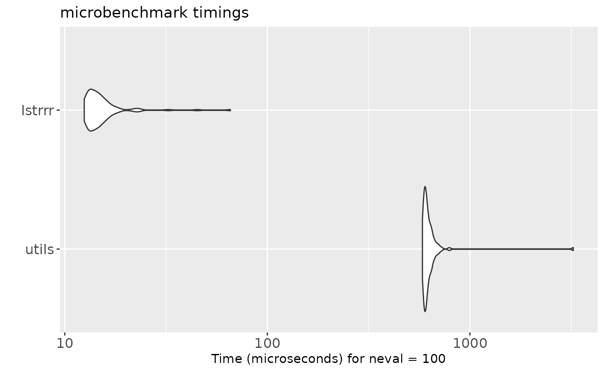

# Performance Benchmarking

``` r

library(lstrrr)
#> ✔ lstrrr v0.1.1 loaded
data(sputnik_1)
```

## Map & Walk

Here, we will use a simple example to illustrate the performance
difference of `lstrrr`.

``` r

files <- list.files(all.files = TRUE, recursive = TRUE)
files_list <- dir_listwise(files)
```

``` r

slow_string_op <- function(x, n = 10) {
  stopifnot(is.character(x))

  out <- x

  for (i in seq_len(n)) {
    out <- paste0(
      rev(strsplit(out, "", fixed = TRUE)[[1]]),
      collapse = ""
    )
    out <- toupper(out)
    out <- tolower(out)
  }

  out
}

set.seed(123)

bench_map <- microbenchmark::microbenchmark(
  purrr_10 = {
    purrr::walk(files, \(x) slow_string_op(x))
  },
  lstrrr_10 = {
    list_walk(files_list, \(x) slow_string_op(x))
  },
  rrapply_10 = {
    rrapply::rrapply(files_list, f = \(x) slow_string_op(x))
  },
  purrr_50 = {
    purrr::walk(files, \(x) slow_string_op(x, n = 50))
  },
  lstrrr_50 = {
    list_walk(files_list, \(x) slow_string_op(x, n = 50))
  },
  rrapply_50 = {
    rrapply::rrapply(files_list, f = \(x) slow_string_op(x, n = 50))
  }
  # ,
  # purrr_100 = {
  #   purrr::walk(files, \(x) slow_string_op(x, n = 100))
  # },
  # lstrrr_100 = {
  #   list_walk(files_list, \(x) slow_string_op(x, n = 100))
  # },
  # rrapply_100 = {
  #   rrapply::rrapply(files_list, f = \(x) slow_string_op(x, n = 100))
  # }
)
print(bench_map)
#> Unit: milliseconds
#>        expr       min        lq      mean    median        uq       max neval
#>    purrr_10  2.842734  2.924511  3.677509  2.968956  3.003343 44.658324   100
#>   lstrrr_10  2.816564  2.888757  3.147370  2.934870  2.959937  6.726386   100
#>  rrapply_10  2.848301  2.910264  3.094095  2.944159  2.978852 10.564102   100
#>    purrr_50 13.629537 14.041110 14.619423 14.158234 14.315182 26.130844   100
#>   lstrrr_50 13.760311 14.097223 14.980813 14.241087 14.614183 19.160674   100
#>  rrapply_50 13.764758 14.148104 14.950472 14.241619 14.538049 18.075438   100
```

``` r

ggplot2::autoplot(bench_map) +
  ggplot2::theme(axis.text = ggplot2::element_text(size = 12))
#> Warning: `aes_string()` was deprecated in ggplot2 3.0.0.
#> ℹ Please use tidy evaluation idioms with `aes()`.
#> ℹ See also `vignette("ggplot2-in-packages")` for more information.
#> ℹ The deprecated feature was likely used in the microbenchmark package.
#>   Please report the issue at
#>   <https://github.com/joshuaulrich/microbenchmark/issues/>.
#> This warning is displayed once per session.
#> Call `lifecycle::last_lifecycle_warnings()` to see where this warning was
#> generated.
```


## Detect Depth

``` r

set.seed(124)

bench_depth <- microbenchmark::microbenchmark(
  purrr = {
    purrr::pluck_depth(sputnik_1)
  },
  lstrrr = {
    list_depth(sputnik_1)
  }
)
print(bench_depth)
#> Unit: microseconds
#>    expr      min        lq       mean    median       uq        max neval
#>   purrr 3747.851 3869.3225 5201.24529 3960.1070 4105.343 110809.244   100
#>  lstrrr    1.983    2.2685    4.24128    3.8055    5.062     35.082   100
```

``` r

ggplot2::autoplot(bench_depth) +
  ggplot2::theme(axis.text = ggplot2::element_text(size = 12))
```


## Assignment

``` r

set.seed(125)

bench_assign <- microbenchmark::microbenchmark(
  purrr = {
    purrr::list_assign(sputnik_1, z = list(a = 1:5))
  },
  lstrrr = {
    list_set(sputnik_1, c("z"), list(a = 1:5))
  }
)
print(bench_assign)
#> Unit: microseconds
#>    expr    min      lq     mean median     uq     max neval
#>   purrr 14.812 15.2580 18.81461 15.548 15.884 308.059   100
#>  lstrrr  1.492  1.5925  1.92720  1.728  1.868  18.077   100
```

``` r

ggplot2::autoplot(bench_assign) +
  ggplot2::theme(axis.text = ggplot2::element_text(size = 12))
```


## Modification

``` r

set.seed(126)

bench_modify <- microbenchmark::microbenchmark(
  purrr = {
    purrr::list_modify(sputnik_1, test_branches = list(null_leaf = 1:5))
  },
  lstrrr = {
    list_set(sputnik_1, c("test_branches", "null_leaf"), 1:5)
  }
)
print(bench_modify)
#> Unit: microseconds
#>    expr    min      lq     mean  median      uq     max neval
#>   purrr 25.978 26.5995 28.90147 27.2005 27.7010 156.143   100
#>  lstrrr  1.382  1.5220  1.76686  1.5875  1.7125  15.263   100
```

``` r

ggplot2::autoplot(bench_modify) +
  ggplot2::theme(axis.text = ggplot2::element_text(size = 12))
```


## Modification Under Condition

``` r

set.seed(1260)

bench_modify_cond <- microbenchmark::microbenchmark(
  rrapply = {
    rrapply::rrapply(
      sputnik_1,
      f = function(x) x**2,
      classes = "numeric",
      condition = function(x) x >= 10
    )
  },
  lstrrr = {
    list_modify_if(sputnik_1, function(x) is.numeric(x) & x >= 10, function(x) {
      x**2
    })
  }
)
print(bench_modify_cond)
#> Unit: microseconds
#>     expr     min       lq      mean  median       uq      max neval
#>  rrapply  37.947  42.6335  59.77829  45.788  50.1500 1354.066   100
#>   lstrrr 890.977 907.7765 979.25226 918.838 941.6775 3712.469   100
```

``` r

ggplot2::autoplot(bench_modify_cond) +
  ggplot2::theme(axis.text = ggplot2::element_text(size = 12))
```


## Flatten

``` r

set.seed(127)

bench_flatten <- microbenchmark::microbenchmark(
  purrr = {
    purrr::list_flatten(sputnik_1)
  },
  lstrrr = {
    list_flatten(sputnik_1)
  },
  rrapply = {
    rrapply::rrapply(sputnik_1, how = "flatten")
  }
)
print(bench_flatten)
#> Unit: microseconds
#>     expr     min       lq      mean   median      uq      max neval
#>    purrr 847.893 903.5505 975.49534 924.5815 964.872 3777.355   100
#>   lstrrr  25.377  28.8430  32.80478  32.0075  35.282   81.271   100
#>  rrapply  25.969  29.3990  34.86152  34.1010  38.282   75.342   100
```

``` r

ggplot2::autoplot(bench_flatten) +
  ggplot2::theme(axis.text = ggplot2::element_text(size = 12))
```


## modifyList

``` r

set.seed(128)

foo <- sputnik_1
foo$test_branches$empty_branch$score <- 1e-256

bench_modify_list <- microbenchmark::microbenchmark(
  utils = {
    utils::modifyList(sputnik_1, foo)
  },
  lstrrr = {
    modify_list(sputnik_1, foo)
  }
)
print(bench_modify_list)
#> Unit: microseconds
#>    expr     min       lq      mean   median      uq      max neval
#>   utils 582.657 596.5985 645.97140 608.4160 635.296 3235.879   100
#>  lstrrr  12.468  13.2795  15.74163  14.2815  15.593   65.708   100
```

``` r

ggplot2::autoplot(bench_modify_list) +
  ggplot2::theme(axis.text = ggplot2::element_text(size = 12))
```



## Parallel Computation

Most of logic is in C implementation, so the acceleration is not that
obvious.

``` r

set.seed(129)
mirai::daemons(3L)
crate <- purrr::in_parallel(
  \(x) {
    slow_string_op(x, n = 10)
  },
  slow_string_op = slow_string_op
)
fn <- function(x) {
  slow_string_op(x, n = 10)
}

bench_parallel <- microbenchmark::microbenchmark(
  lstrrr_parallel = {
    list_map(files_list, crate)
  },
  lstrrr = {
    list_map(files_list, fn)
  },
  purrr = {
    purrr::map(files, fn)
  },
  purrr_parallel = {
    purrr::map(files, crate)
  }
)
mirai::daemons(0L)
print(bench_parallel)
#> Unit: milliseconds
#>             expr      min       lq     mean   median       uq       max neval
#>  lstrrr_parallel 2.877705 2.987760 3.036089 3.028274 3.064328  3.338872   100
#>           lstrrr 2.750757 2.823514 3.099370 2.856594 2.922246 10.570871   100
#>            purrr 2.773691 2.869674 3.176333 2.905812 2.962677 10.011630   100
#>   purrr_parallel 6.433050 6.856931 7.295807 7.069681 7.311471 13.316044   100
```

``` r

ggplot2::autoplot(bench_parallel) +
  ggplot2::theme(axis.text = ggplot2::element_text(size = 12))
```


