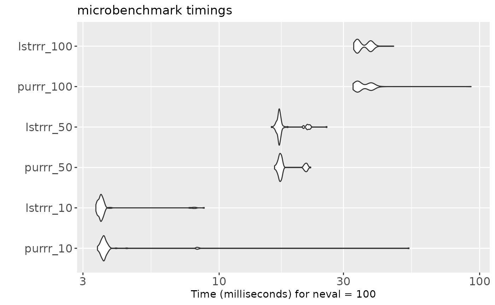
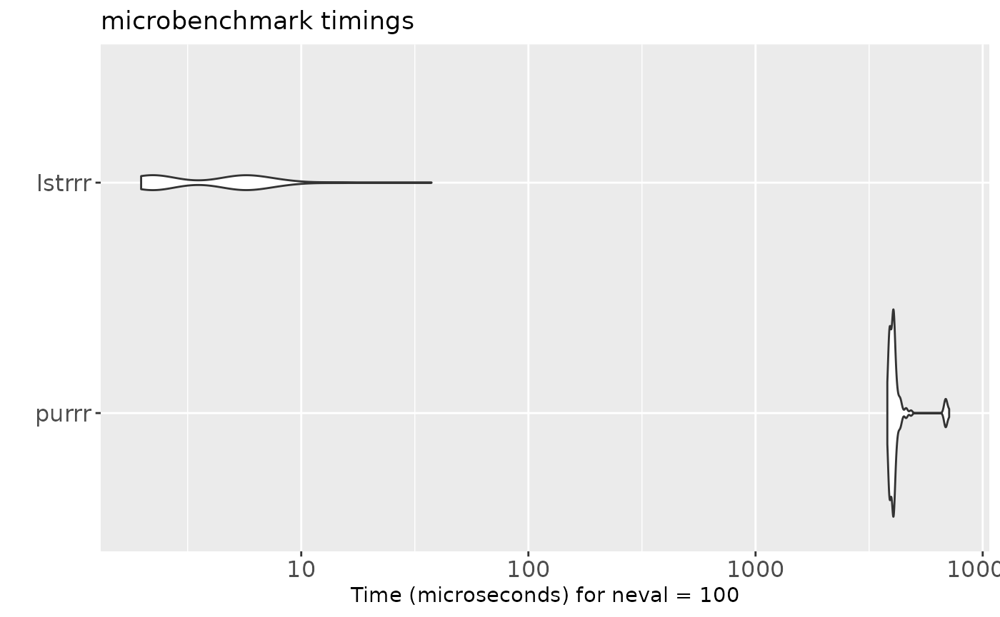
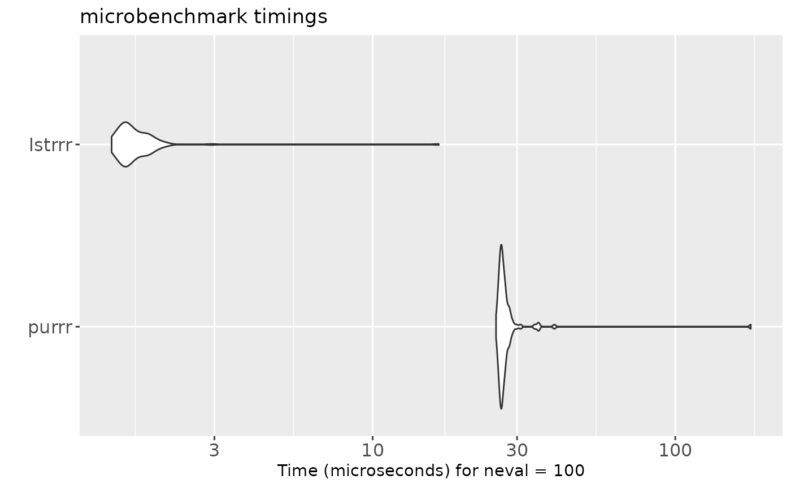

# Performance Benchmarking

``` r

library(lstrrr)
#> ✔ lstrrr v0.1.0 loaded
data(sputnik_1)
```

## Map & Walk

Here, we will use a simple example to illustrate the performance
difference of `lstrrr`.

``` r

files <- list.files(all.files = TRUE, recursive = TRUE)
files_list <- dir_listwise(files)
```

``` r

slow_string_op <- function(x, n = 10) {
  stopifnot(is.character(x))

  out <- x

  for (i in seq_len(n)) {
    out <- paste0(
      rev(strsplit(out, "", fixed = TRUE)[[1]]),
      collapse = ""
    )
    out <- toupper(out)
    out <- tolower(out)
  }

  out
}

set.seed(123)

bench_map <- microbenchmark::microbenchmark(
  purrr_10 = {
    purrr::walk(files, \(x) slow_string_op(x))
  },
  lstrrr_10 = {
    list_walk(files_list, \(x) slow_string_op(x))
  },
  purrr_50 = {
    purrr::walk(files, \(x) slow_string_op(x, n = 50))
  },
  lstrrr_50 = {
    list_walk(files_list, \(x) slow_string_op(x, n = 50))
  },
  purrr_100 = {
    purrr::walk(files, \(x) slow_string_op(x, n = 100))
  },
  lstrrr_100 = {
    list_walk(files_list, \(x) slow_string_op(x, n = 100))
  }
)
print(bench_map)
#> Unit: milliseconds
#>        expr       min        lq      mean    median        uq      max neval
#>    purrr_10  3.410271  3.545301  4.297314  3.605756  3.669977 53.54569   100
#>   lstrrr_10  3.362640  3.458302  3.745305  3.517645  3.576458  8.76341   100
#>    purrr_50 16.314968 16.993607 18.035075 17.201381 17.527140 22.46480   100
#>   lstrrr_50 15.859661 16.865977 17.834599 17.047002 17.291966 25.91676   100
#>   purrr_100 32.662474 34.014725 36.356021 34.439687 38.208565 92.70551   100
#>  lstrrr_100 32.849042 33.870586 35.940210 34.406588 38.078162 46.77079   100
```

``` r

ggplot2::autoplot(bench_map) +
  ggplot2::theme(axis.text = ggplot2::element_text(size = 12))
#> Warning: `aes_string()` was deprecated in ggplot2 3.0.0.
#> ℹ Please use tidy evaluation idioms with `aes()`.
#> ℹ See also `vignette("ggplot2-in-packages")` for more information.
#> ℹ The deprecated feature was likely used in the microbenchmark package.
#>   Please report the issue at
#>   <https://github.com/joshuaulrich/microbenchmark/issues/>.
#> This warning is displayed once per session.
#> Call `lifecycle::last_lifecycle_warnings()` to see where this warning was
#> generated.
```



## Detect Depth

``` r

set.seed(124)

bench_depth <- microbenchmark::microbenchmark(
  purrr = {
    purrr::pluck_depth(sputnik_1)
  },
  lstrrr = {
    list_depth(sputnik_1)
  }
)
print(bench_depth)
#> Unit: microseconds
#>    expr      min        lq       mean   median       uq      max neval
#>   purrr 3803.545 3911.0955 4241.79746 4036.647 4126.601 7117.593   100
#>  lstrrr    1.973    2.1985    4.79397    4.722    5.809   37.466   100
```

``` r

ggplot2::autoplot(bench_depth) +
  ggplot2::theme(axis.text = ggplot2::element_text(size = 12))
```



## Assignment

``` r

set.seed(125)

bench_assign <- microbenchmark::microbenchmark(
  purrr = {
    purrr::list_assign(sputnik_1, z = list(a = 1:5))
  },
  lstrrr = {
    list_set(sputnik_1, c("z"), list(a = 1:5))
  }
)
print(bench_assign)
#> Unit: microseconds
#>    expr    min      lq     mean median     uq     max neval
#>   purrr 14.772 15.0575 19.00410 15.378 15.899 332.064   100
#>  lstrrr  1.462  1.6080  1.96052  1.722  1.857  22.904   100
```

``` r

ggplot2::autoplot(bench_assign) +
  ggplot2::theme(axis.text = ggplot2::element_text(size = 12))
```


## Modification

``` r

set.seed(126)

bench_modify <- microbenchmark::microbenchmark(
  purrr = {
    purrr::list_modify(sputnik_1, test_branches = list(null_leaf = 1:5))
  },
  lstrrr = {
    list_set(sputnik_1, c("test_branches", "null_leaf"), 1:5)
  }
)
print(bench_modify)
#> Unit: microseconds
#>    expr    min      lq     mean  median      uq     max neval
#>   purrr 25.568 26.4195 28.87368 26.8300 27.5010 177.634   100
#>  lstrrr  1.372  1.5020  1.77978  1.5675  1.7625  16.534   100
```

``` r

ggplot2::autoplot(bench_modify) +
  ggplot2::theme(axis.text = ggplot2::element_text(size = 12))
```



## Flatten

``` r

set.seed(127)

bench_flatten <- microbenchmark::microbenchmark(
  purrr = {
    purrr::list_flatten(sputnik_1)
  },
  lstrrr = {
    list_flatten(sputnik_1)
  }
)
print(bench_flatten)
#> Unit: microseconds
#>    expr     min      lq      mean   median       uq      max neval
#>   purrr 864.655 891.926 972.54582 922.4765 967.9045 3706.761   100
#>  lstrrr  24.977  29.644  33.35854  31.4470  35.6530   91.887   100
```

``` r

ggplot2::autoplot(bench_flatten) +
  ggplot2::theme(axis.text = ggplot2::element_text(size = 12))
```


## modifyList

``` r

set.seed(128)

foo <- sputnik_1
foo$test_branches$empty_branch$score <- 1e-256

bench_modify_list <- microbenchmark::microbenchmark(
  utils = {
    utils::modifyList(sputnik_1, foo)
  },
  lstrrr = {
    modify_list(sputnik_1, foo)
  }
)
print(bench_modify_list)
#> Unit: microseconds
#>    expr     min       lq      mean  median       uq      max neval
#>   utils 589.677 599.5165 645.96378 610.533 625.7655 3431.082   100
#>  lstrrr  12.659  13.5500  15.17506  14.161  15.0720   84.285   100
```

``` r

ggplot2::autoplot(bench_modify_list) +
  ggplot2::theme(axis.text = ggplot2::element_text(size = 12))
```


## Parallel Computation

Most of logic is in C implementation, so the acceleration is not that
obvious.

``` r

set.seed(129)
mirai::daemons(3L)
crate <- purrr::in_parallel(
  \(x) {
    slow_string_op(x, n = 10)
  },
  slow_string_op = slow_string_op
)
fn <- function(x) {
  slow_string_op(x, n = 10)
}

bench_parallel <- microbenchmark::microbenchmark(
  lstrrr_parallel = {
    list_map(files_list, crate)
  },
  lstrrr = {
    list_map(files_list, fn)
  },
  purrr = {
    purrr::map(files, fn)
  },
  purrr_parallel = {
    purrr::map(files, crate)
  }
)
mirai::daemons(0L)
print(bench_parallel)
#> Unit: milliseconds
#>             expr      min       lq     mean   median       uq      max neval
#>  lstrrr_parallel 3.543438 3.600383 3.887280 3.643948 3.707522 12.08487   100
#>           lstrrr 3.339055 3.392650 3.521817 3.426360 3.472002 10.98174   100
#>            purrr 3.372594 3.443064 3.799679 3.480295 3.556849 13.29755   100
#>   purrr_parallel 8.411927 8.887134 9.381990 9.181231 9.453261 12.97562   100
```

``` r

ggplot2::autoplot(bench_parallel) +
  ggplot2::theme(axis.text = ggplot2::element_text(size = 12))
```


