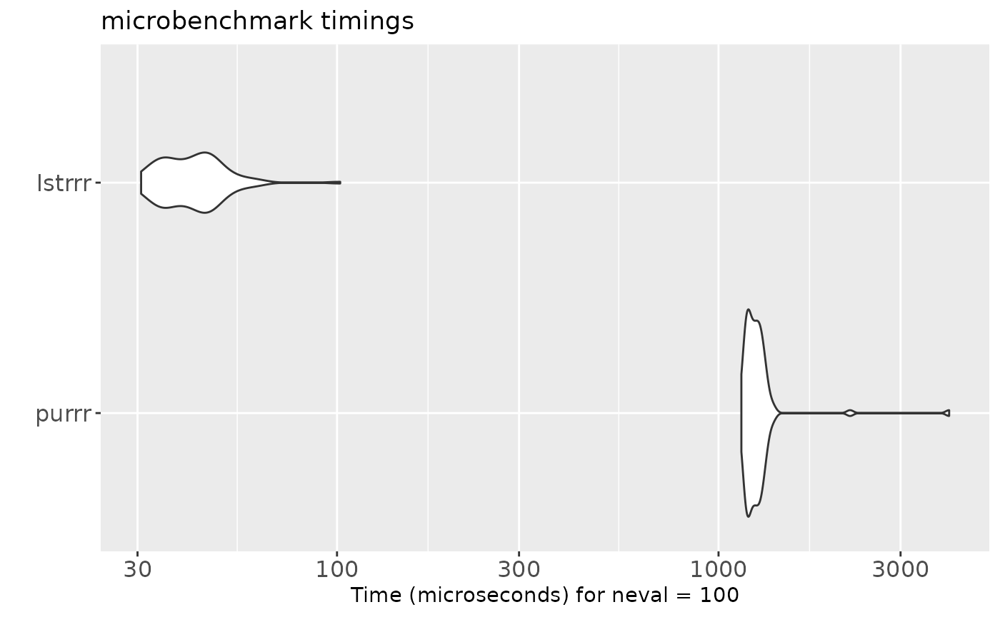
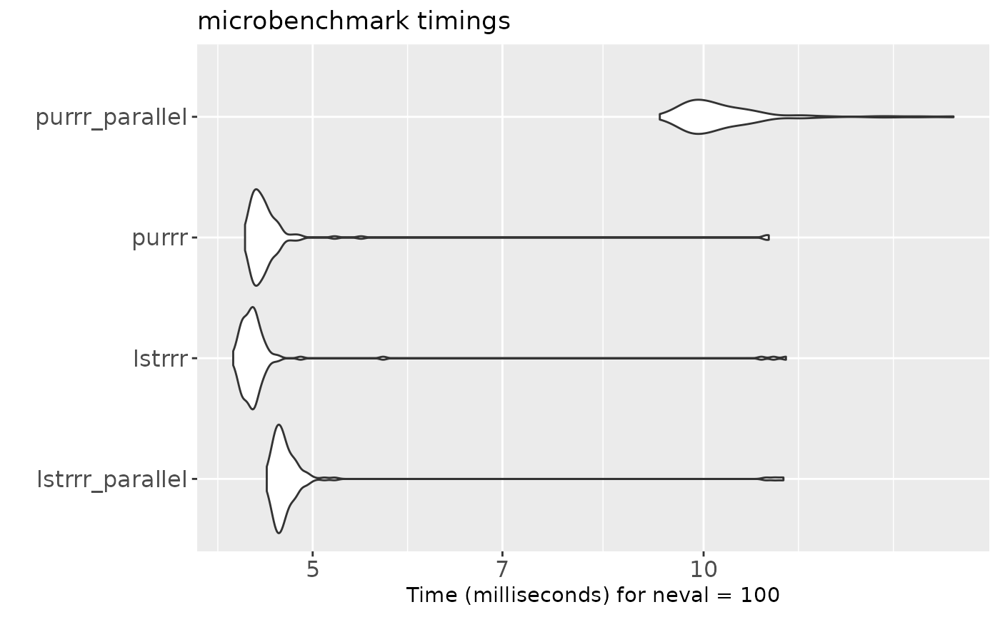

# Performance Benchmarking

``` r

library(lstrrr)
#> ✔ lstrrr v0.1.0 loaded
data(sputnik_1)
```

## Map & Walk

Here, we will use a simple example to illustrate the performance
difference of `lstrrr`.

``` r

files <- list.files(all.files = TRUE, recursive = TRUE)
files_list <- dir_listwise(files)
```

``` r

slow_string_op <- function(x, n = 10) {
  stopifnot(is.character(x))

  out <- x

  for (i in seq_len(n)) {
    out <- paste0(
      rev(strsplit(out, "", fixed = TRUE)[[1]]),
      collapse = ""
    )
    out <- toupper(out)
    out <- tolower(out)
  }

  out
}

set.seed(123)

bench_map <- microbenchmark::microbenchmark(
  purrr_10 = {
    purrr::walk(files, \(x) slow_string_op(x))
  },
  lstrrr_10 = {
    list_walk(files_list, \(x) slow_string_op(x))
  },
  purrr_50 = {
    purrr::walk(files, \(x) slow_string_op(x, n = 50))
  },
  lstrrr_50 = {
    list_walk(files_list, \(x) slow_string_op(x, n = 50))
  },
  purrr_100 = {
    purrr::walk(files, \(x) slow_string_op(x, n = 100))
  },
  lstrrr_100 = {
    list_walk(files_list, \(x) slow_string_op(x, n = 100))
  }
)
print(bench_map)
#> Unit: milliseconds
#>        expr       min        lq      mean    median        uq       max neval
#>    purrr_10  4.413098  4.519794  5.335495  4.551298  4.587898 58.925036   100
#>   lstrrr_10  4.326203  4.428137  4.651793  4.450660  4.485107  9.434403   100
#>    purrr_50 20.953109 21.478680 23.209162 21.640026 22.104470 78.207777   100
#>   lstrrr_50 21.026992 21.405317 22.379381 21.529590 21.777024 31.584365   100
#>   purrr_100 42.170527 42.909332 44.953505 43.247391 47.422455 56.037036   100
#>  lstrrr_100 41.726338 42.903599 45.035032 43.325865 47.320591 49.573573   100
```

``` r

ggplot2::autoplot(bench_map) +
  ggplot2::theme(axis.text = ggplot2::element_text(size = 12))
#> Warning: `aes_string()` was deprecated in ggplot2 3.0.0.
#> ℹ Please use tidy evaluation idioms with `aes()`.
#> ℹ See also `vignette("ggplot2-in-packages")` for more information.
#> ℹ The deprecated feature was likely used in the microbenchmark package.
#>   Please report the issue at
#>   <https://github.com/joshuaulrich/microbenchmark/issues/>.
#> This warning is displayed once per session.
#> Call `lifecycle::last_lifecycle_warnings()` to see where this warning was
#> generated.
```


## Detect Depth

``` r

set.seed(124)

bench_depth <- microbenchmark::microbenchmark(
  purrr = {
    purrr::pluck_depth(sputnik_1)
  },
  lstrrr = {
    list_depth(sputnik_1)
  }
)
print(bench_depth)
#> Unit: microseconds
#>    expr      min        lq       mean    median        uq      max neval
#>   purrr 4930.619 4999.6695 5288.52755 5056.2840 5246.5280 7985.417   100
#>  lstrrr    2.189    2.3915    5.51545    5.6385    7.1365   48.328   100
```

``` r

ggplot2::autoplot(bench_depth) +
  ggplot2::theme(axis.text = ggplot2::element_text(size = 12))
```


## Assignment

``` r

set.seed(125)

bench_assign <- microbenchmark::microbenchmark(
  purrr = {
    purrr::list_assign(sputnik_1, z = list(a = 1:5))
  },
  lstrrr = {
    list_set(sputnik_1, c("z"), list(a = 1:5))
  }
)
print(bench_assign)
#> Unit: microseconds
#>    expr    min      lq     mean median      uq     max neval
#>   purrr 19.210 19.6860 24.01126 19.929 21.1455 356.272   100
#>  lstrrr  1.884  2.0185  2.40193  2.182  2.3695  18.410   100
```

``` r

ggplot2::autoplot(bench_assign) +
  ggplot2::theme(axis.text = ggplot2::element_text(size = 12))
```


## Modification

``` r

set.seed(126)

bench_modify <- microbenchmark::microbenchmark(
  purrr = {
    purrr::list_modify(sputnik_1, test_branches = list(null_leaf = 1:5))
  },
  lstrrr = {
    list_set(sputnik_1, c("test_branches", "null_leaf"), 1:5)
  }
)
print(bench_modify)
#> Unit: microseconds
#>    expr    min     lq     mean  median      uq     max neval
#>   purrr 33.806 34.139 38.63983 34.6805 37.0215 176.941   100
#>  lstrrr  1.703  1.872  2.31700  2.0245  2.3050  14.125   100
```

``` r

ggplot2::autoplot(bench_modify) +
  ggplot2::theme(axis.text = ggplot2::element_text(size = 12))
```


## Flatten

``` r

set.seed(127)

bench_flatten <- microbenchmark::microbenchmark(
  purrr = {
    purrr::list_flatten(sputnik_1)
  },
  lstrrr = {
    list_flatten(sputnik_1)
  }
)
print(bench_flatten)
#> Unit: microseconds
#>    expr      min       lq       mean    median        uq      max neval
#>   purrr 1147.875 1193.362 1280.77041 1238.8065 1288.0700 4022.542   100
#>  lstrrr   30.659   35.386   42.44384   41.5735   46.6325  101.952   100
```

``` r

ggplot2::autoplot(bench_flatten) +
  ggplot2::theme(axis.text = ggplot2::element_text(size = 12))
```



## modifyList

``` r

set.seed(128)

foo <- sputnik_1
foo$test_branches$empty_branch$score <- 1e-256

bench_modify_list <- microbenchmark::microbenchmark(
  utils = {
    utils::modifyList(sputnik_1, foo)
  },
  lstrrr = {
    modify_list(sputnik_1, foo)
  }
)
print(bench_modify_list)
#> Unit: microseconds
#>    expr     min      lq      mean   median       uq      max neval
#>   utils 688.225 712.428 774.88010 726.3845 767.0370 3488.774   100
#>  lstrrr  16.285  17.095  19.30276  18.1090  20.0385   78.015   100
```

``` r

ggplot2::autoplot(bench_modify_list) +
  ggplot2::theme(axis.text = ggplot2::element_text(size = 12))
```


## Parallel Computation

Most of logic is in C implementation, so the acceleration is not that
obvious.

``` r

set.seed(129)
mirai::daemons(3L)
crate <- purrr::in_parallel(
  \(x) {
    slow_string_op(x, n = 10)
  },
  slow_string_op = slow_string_op
)
fn <- function(x) {
  slow_string_op(x, n = 10)
}

bench_parallel <- microbenchmark::microbenchmark(
  lstrrr_parallel = {
    list_map(files_list, crate)
  },
  lstrrr = {
    list_map(files_list, fn)
  },
  purrr = {
    purrr::map(files, fn)
  },
  purrr_parallel = {
    purrr::map(files, crate)
  }
)
mirai::daemons(0L)
print(bench_parallel)
#> Unit: milliseconds
#>             expr      min       lq      mean    median        uq      max neval
#>  lstrrr_parallel 4.609078 4.686935  4.951242  4.733194  4.810773 11.52125   100
#>           lstrrr 4.342726 4.431280  4.707231  4.490182  4.533817 11.57224   100
#>            purrr 4.434767 4.507450  4.722065  4.558922  4.631694 11.22545   100
#>   purrr_parallel 9.252839 9.783129 10.397968 10.134358 10.629319 15.57657   100
```

``` r

ggplot2::autoplot(bench_parallel) +
  ggplot2::theme(axis.text = ggplot2::element_text(size = 12))
```


