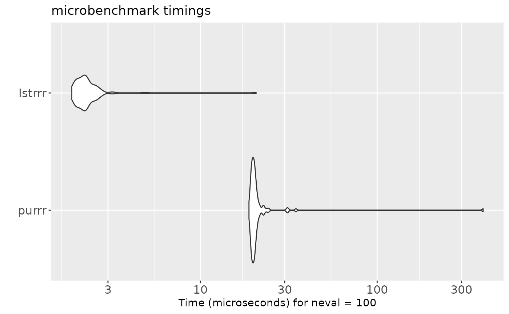
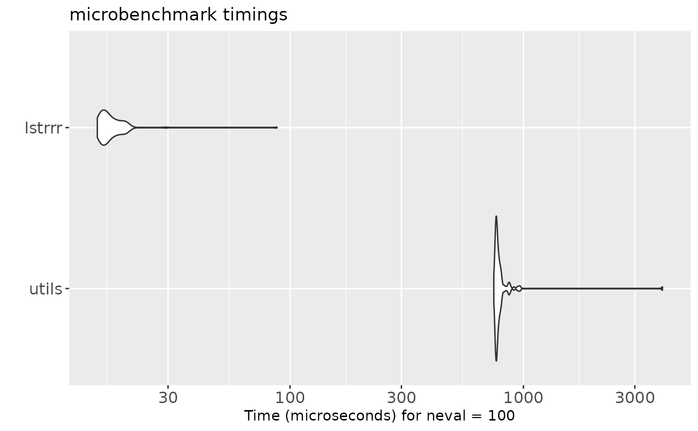

# Performance Benchmarking

``` r

library(lstrrr)
#> ✔ lstrrr v0.1.0 loaded
```

## Map & Walk

Here, we will use a simple example to illustrate the performance
difference of `lstrrr`.

``` r

files <- list.files(all.files = TRUE, recursive = TRUE)
files_list <- dir_listwise(files)
```

``` r

slow_string_op <- function(x, n = 10) {
  stopifnot(is.character(x))

  out <- x

  for (i in seq_len(n)) {
    out <- paste0(
      rev(strsplit(out, "", fixed = TRUE)[[1]]),
      collapse = ""
    )
    out <- toupper(out)
    out <- tolower(out)
  }

  out
}

set.seed(123)

bench_map <- microbenchmark::microbenchmark(
  purrr = {
    purrr::walk(files, \(x) slow_string_op(x))
  },
  lstrrr = {
    list_walk(files_list, \(x) slow_string_op(x))
  }
)
print(bench_map)
#> Unit: milliseconds
#>    expr      min       lq     mean   median       uq       max neval
#>   purrr 1.849509 1.887195 2.722950 1.923439 1.947339 60.978539   100
#>  lstrrr 1.801768 1.861942 1.991639 1.883474 1.916113  6.167703   100
```

``` r

ggplot2::autoplot(bench_map) +
  ggplot2::theme(axis.text = ggplot2::element_text(size = 12))
#> Warning: `aes_string()` was deprecated in ggplot2 3.0.0.
#> ℹ Please use tidy evaluation idioms with `aes()`.
#> ℹ See also `vignette("ggplot2-in-packages")` for more information.
#> ℹ The deprecated feature was likely used in the microbenchmark package.
#>   Please report the issue at
#>   <https://github.com/joshuaulrich/microbenchmark/issues/>.
#> This warning is displayed once per session.
#> Call `lifecycle::last_lifecycle_warnings()` to see where this warning was
#> generated.
```


I basically use C to implement the `map` like functions. However, the
progress bar implemented on the C side cannot faithfully reproduce the
progress bar from the `cli` package.

## Detect Depth

``` r

set.seed(124)

bench_depth <- microbenchmark::microbenchmark(
  purrr = {
    purrr::pluck_depth(sputnik_1)
  },
  lstrrr = {
    list_depth(sputnik_1)
  }
)
print(bench_depth)
#> Unit: microseconds
#>    expr      min        lq     mean   median       uq      max neval
#>   purrr 4853.167 5012.8930 5352.577 5110.273 5333.503 8371.487   100
#>  lstrrr    2.464    2.7045    5.034    4.642    6.044   46.279   100
```

``` r

ggplot2::autoplot(bench_depth) +
  ggplot2::theme(axis.text = ggplot2::element_text(size = 12))
```


## Assignment

``` r

set.seed(125)

bench_assign <- microbenchmark::microbenchmark(
  purrr = {
    purrr::list_assign(sputnik_1, z = list(a = 1:5))
  },
  lstrrr = {
    list_set(sputnik_1, c("z"), list(a = 1:5))
  }
)
print(bench_assign)
#> Unit: microseconds
#>    expr    min     lq    mean median      uq     max neval
#>   purrr 18.828 19.549 24.3559 20.055 20.5655 397.799   100
#>  lstrrr  1.873  2.043  2.4522  2.218  2.3880  20.661   100
```

``` r

ggplot2::autoplot(bench_assign) +
  ggplot2::theme(axis.text = ggplot2::element_text(size = 12))
```



## Modification

``` r

set.seed(126)

bench_modify <- microbenchmark::microbenchmark(
  purrr = {
    purrr::list_modify(sputnik_1, test_branches = list(null_leaf = 1:5))
  },
  lstrrr = {
    list_set(sputnik_1, c("test_branches", "null_leaf"), 1:5)
  }
)
print(bench_modify)
#> Unit: microseconds
#>    expr    min     lq     mean median      uq     max neval
#>   purrr 33.109 33.985 36.71073 34.391 34.8420 202.720   100
#>  lstrrr  1.773  1.903  2.25314  2.003  2.1635  19.539   100
```

``` r

ggplot2::autoplot(bench_modify) +
  ggplot2::theme(axis.text = ggplot2::element_text(size = 12))
```


## Flatten

``` r

set.seed(127)

bench_flatten <- microbenchmark::microbenchmark(
  purrr = {
    purrr::list_flatten(sputnik_1)
  },
  lstrrr = {
    list_flatten(sputnik_1)
  }
)
print(bench_flatten)
#> Unit: microseconds
#>    expr      min       lq       mean   median        uq      max neval
#>   purrr 1108.262 1149.351 1255.17237 1204.574 1247.6575 4743.044   100
#>  lstrrr   31.537   36.714   42.92412   42.082   46.7895  109.082   100
```

``` r

ggplot2::autoplot(bench_flatten) +
  ggplot2::theme(axis.text = ggplot2::element_text(size = 12))
```


## modifyList

``` r

set.seed(128)

foo <- sputnik_1
foo$test_branches$empty_branch$score <- 1e-256

bench_modify_list <- microbenchmark::microbenchmark(
  utils = {
    utils::modifyList(sputnik_1, foo)
  },
  lstrrr = {
    modify_list(sputnik_1, foo)
  }
)
print(bench_modify_list)
#> Unit: microseconds
#>    expr     min       lq      mean   median       uq      max neval
#>   utils 746.465 763.2650 817.77742 771.4825 790.4505 3941.487   100
#>  lstrrr  14.932  15.7585  17.74693  16.4945  18.0770   87.880   100
```

``` r

ggplot2::autoplot(bench_modify_list) +
  ggplot2::theme(axis.text = ggplot2::element_text(size = 12))
```


