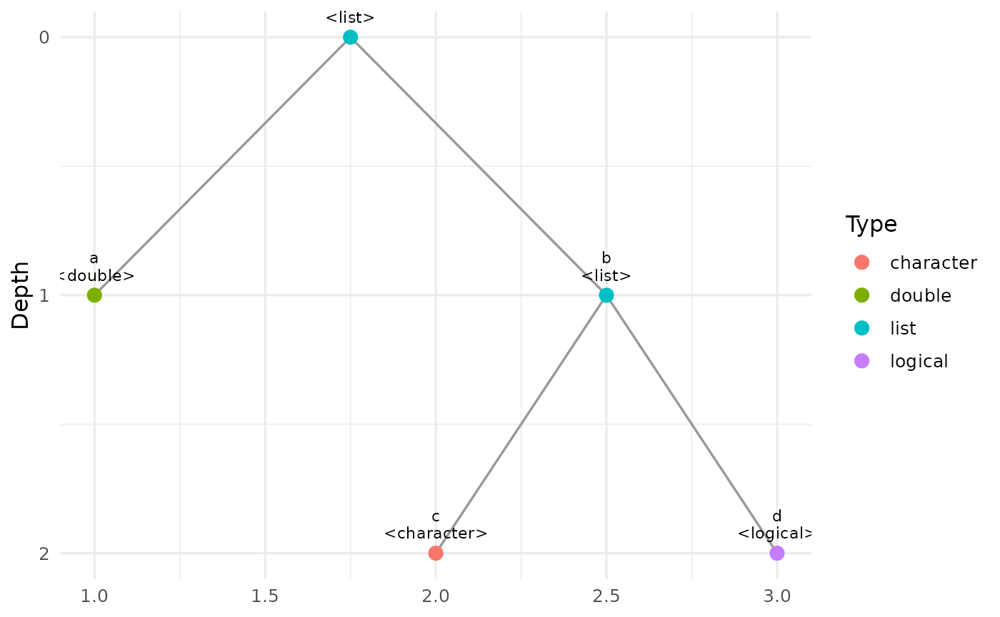

# utilities

> This vignette shows the function utilities of `lstrrr`.

``` r

library(lstrrr)
#> ✔ lstrrr v0.1.1 loaded
```

## TL;DR

| Function              | Description                                        |
|-----------------------|----------------------------------------------------|
| `list_stats(x)`       | Convert a nested list to tree data (nodes + edges) |
| `viz_list(x)`         | Visualize list structure as a tree diagram         |
| `dir_listwise(paths)` | Convert file paths to a nested list                |
| `modify_list(x, val)` | Recursively merge two lists                        |

## modify_list

`modify_list` is similar to
[`utils::modifyList`](https://rdrr.io/r/utils/modifyList.html). In most
cases, we can use `modify_list` to replace
[`utils::modifyList`](https://rdrr.io/r/utils/modifyList.html).

``` r

foo <- list(a = 1, b = list(c = "a", d = FALSE))
bar <- list(e = 2, b = list(d = TRUE))
```

``` r

v1 <- modify_list(foo, bar)
str(v1)
#> List of 3
#>  $ a: num 1
#>  $ b:List of 2
#>   ..$ c: chr "a"
#>   ..$ d: logi TRUE
#>  $ e: num 2
v2 <- utils::modifyList(foo, bar)
str(v2)
#> List of 3
#>  $ a: num 1
#>  $ b:List of 2
#>   ..$ c: chr "a"
#>   ..$ d: logi TRUE
#>  $ e: num 2

identical(v1, v2)
#> [1] TRUE
```

The only difference is that `modify_list` keeps the unnamed elements.

``` r

bar2 <- list(e = 2, b = list(d = TRUE), 3, data.frame())
v3 <- modify_list(foo, bar2)
str(v3)
#> List of 5
#>  $ a: num 1
#>  $ b:List of 2
#>   ..$ c: chr "a"
#>   ..$ d: logi TRUE
#>  $ e: num 2
#>  $  : num 3
#>  $  :'data.frame':   0 obs. of  0 variables
v4 <- utils::modifyList(foo, bar2)
str(v4)
#> List of 3
#>  $ a: num 1
#>  $ b:List of 2
#>   ..$ c: chr "a"
#>   ..$ d: logi TRUE
#>  $ e: num 2

identical(v3, v4)
#> [1] FALSE
```

## Make `list.files` Result into a List

``` r

files <- list.files(".", recursive = TRUE, full.names = TRUE)
head(files)
#> [1] "./benchmark.md"                                                             
#> [2] "./benchmark.Rmd"                                                            
#> [3] "./do_purrrlike_cache/html/__packages"                                       
#> [4] "./do_purrrlike_cache/html/list_pwalk_0f1131d1965314cb05dd2699ffbc33eb.cast" 
#> [5] "./do_purrrlike_cache/html/list_pwalk_0f1131d1965314cb05dd2699ffbc33eb.RData"
#> [6] "./do_purrrlike_cache/html/list_pwalk_0f1131d1965314cb05dd2699ffbc33eb.rdb"

files_list <- dir_listwise(files)
cli::cli_alert_info("Class of files_list: {.cls {class(files_list)}}")
#> ℹ Class of files_list: <list>
```

## Statistics for R list

[`list_stats()`](https://exceret.github.io/lstrrr/reference/list_stats.md)
is a function to get the statistics of a list. The result is a list
containing 2 elements: `nodes` and `edges`.

``` r

list_stats(foo)
#> $nodes
#>   id parent name      type     path depth is_leaf
#> 1  1     NA root      list     root     0   FALSE
#> 2  2      1    a    double   root.a     1    TRUE
#> 3  3      1    b      list   root.b     1   FALSE
#> 4  4      3    c character root.b.c     2    TRUE
#> 5  5      3    d   logical root.b.d     2    TRUE
#> 
#> $edges
#>   from to
#> 1    1  2
#> 2    1  3
#> 3    3  4
#> 4    3  5
```

## Visualize R list

[`viz_list()`](https://exceret.github.io/lstrrr/reference/viz_list.md)
is a function to visualize a list. The result is a `ggplot2` object.

``` r

viz_list(foo)
```



It is useful to get a sense of the structure of a complex list.

``` r

viz_list(sputnik_1, point_size = 1.5, text_size = 1L, line_width = 0.6) +
  ggplot2::coord_flip()
```


