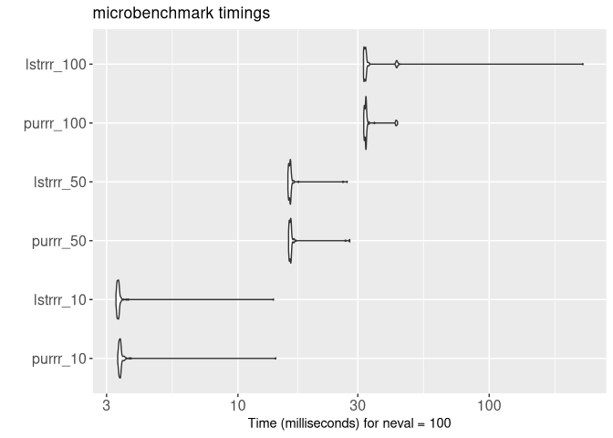
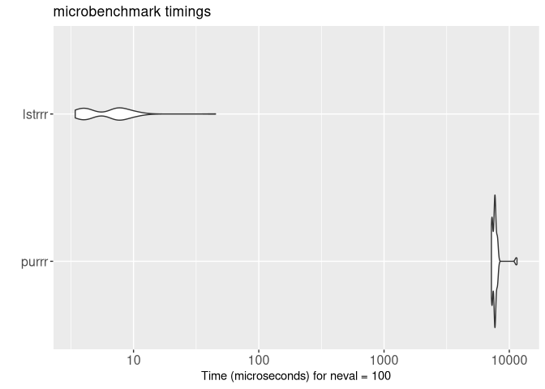
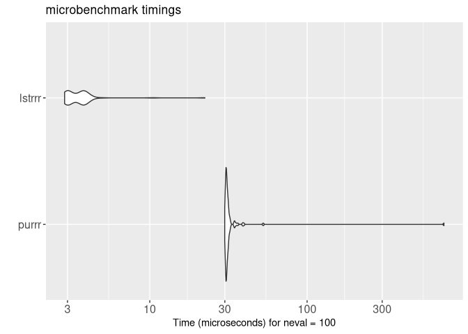
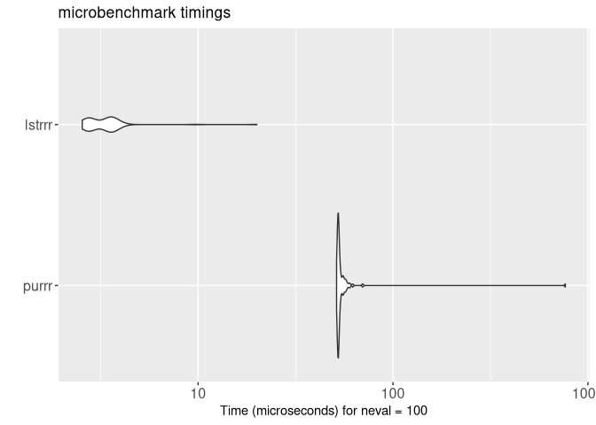
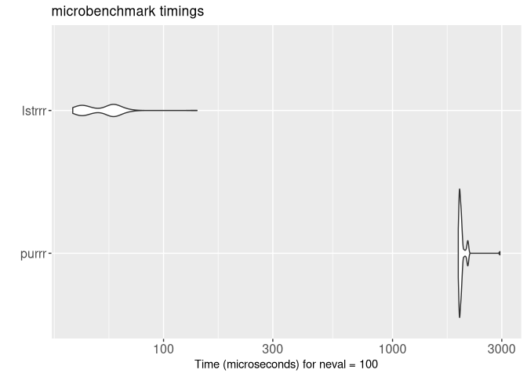
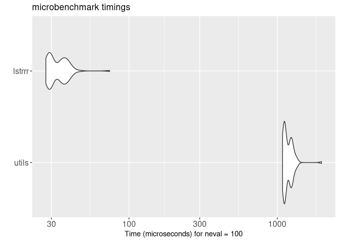
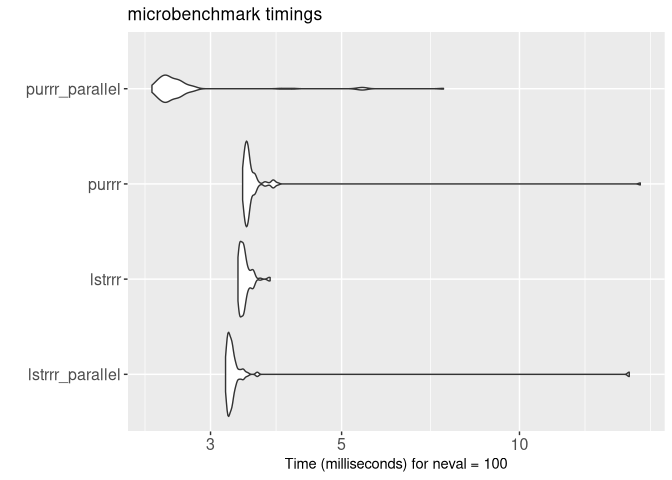

    library(lstrrr)
    data(sputnik_1)

## Map & Walk

Here, we will use a simple example to illustrate the performance
difference of `lstrrr`.

    files <- list.files(all.files = TRUE, recursive = TRUE)
    files_list <- dir_listwise(files)

    slow_string_op <- function(x, n = 10) {
      stopifnot(is.character(x))

      out <- x

      for (i in seq_len(n)) {
        out <- paste0(
          rev(strsplit(out, "", fixed = TRUE)[[1]]),
          collapse = ""
        )
        out <- toupper(out)
        out <- tolower(out)
      }

      out
    }

    set.seed(123)

    bench_map <- microbenchmark::microbenchmark(
      purrr_10 = {
        purrr::walk(files, \(x) slow_string_op(x))
      },
      lstrrr_10 = {
        list_walk(files_list, \(x) slow_string_op(x))
      },
      purrr_50 = {
        purrr::walk(files, \(x) slow_string_op(x, n = 50))
      },
      lstrrr_50 = {
        list_walk(files_list, \(x) slow_string_op(x, n = 50))
      },
      purrr_100 = {
        purrr::walk(files, \(x) slow_string_op(x, n = 100))
      },
      lstrrr_100 = {
        list_walk(files_list, \(x) slow_string_op(x, n = 100))
      }
    )
    print(bench_map)
    #> Unit: milliseconds
    #>        expr       min        lq      mean    median        uq       max neval
    #>    purrr_10  63.92014  64.53322  66.76019  64.77784  65.25634  88.29130   100
    #>   lstrrr_10  63.77310  64.39355  67.07866  64.63867  65.19368  83.91031   100
    #>    purrr_50 314.36159 316.10404 328.59784 327.99516 330.39642 508.49412   100
    #>   lstrrr_50 313.04120 315.51708 326.88509 327.49779 329.60165 502.00026   100
    #>   purrr_100 637.59407 643.94502 657.62831 646.52496 655.32082 827.41176   100
    #>  lstrrr_100 638.14487 643.21034 655.76381 645.37794 655.92782 828.65521   100

    ggplot2::autoplot(bench_map) +
      ggplot2::theme(axis.text = ggplot2::element_text(size = 12))
    #> Warning: `aes_string()` was deprecated in ggplot2 3.0.0.
    #> ℹ Please use tidy evaluation idioms with `aes()`.
    #> ℹ See also `vignette("ggplot2-in-packages")` for more information.
    #> ℹ The deprecated feature was likely used in the microbenchmark package.
    #>   Please report the issue at <]8;;https://github.com/joshuaulrich/microbenchmark/issues/https://github.com/joshuaulrich/microbenchmark/issues/]8;;>.
    #> This warning is displayed once per session.
    #> Call ]8;;x-r-run:lifecycle::last_lifecycle_warnings()lifecycle::last_lifecycle_warnings()]8;; to see where this warning was generated.

## Detect Depth

    set.seed(124)

    bench_depth <- microbenchmark::microbenchmark(
      purrr = {
        purrr::pluck_depth(sputnik_1)
      },
      lstrrr = {
        list_depth(sputnik_1)
      }
    )
    print(bench_depth)
    #> Unit: microseconds
    #>    expr      min        lq       mean   median        uq       max neval
    #>   purrr 7197.361 7313.7890 7718.24555 7667.909 7747.4575 11516.752   100
    #>  lstrrr    3.425    4.1185    6.75471    7.081    7.8715    45.134   100

    ggplot2::autoplot(bench_depth) +
      ggplot2::theme(axis.text = ggplot2::element_text(size = 12))

## Assignment

    set.seed(125)

    bench_assign <- microbenchmark::microbenchmark(
      purrr = {
        purrr::list_assign(sputnik_1, z = list(a = 1:5))
      },
      lstrrr = {
        list_set(sputnik_1, c("z"), list(a = 1:5))
      }
    )
    print(bench_assign)
    #> Unit: microseconds
    #>    expr    min      lq     mean  median      uq     max neval
    #>   purrr 29.950 30.4760 38.55727 30.8155 31.4275 740.738   100
    #>  lstrrr  2.876  3.0015  3.71832  3.5645  3.8135  22.410   100

    ggplot2::autoplot(bench_assign) +
      ggplot2::theme(axis.text = ggplot2::element_text(size = 12))

## Modification

    set.seed(126)

    bench_modify <- microbenchmark::microbenchmark(
      purrr = {
        purrr::list_modify(sputnik_1, test_branches = list(null_leaf = 1:5))
      },
      lstrrr = {
        list_set(sputnik_1, c("test_branches", "null_leaf"), 1:5)
      }
    )
    print(bench_modify)
    #> Unit: microseconds
    #>    expr    min      lq     mean  median      uq     max neval
    #>   purrr 51.343 52.1605 60.59294 52.5965 53.6925 766.258   100
    #>  lstrrr  2.545  2.7575  3.46058  3.3680  3.6385  20.016   100

    ggplot2::autoplot(bench_modify) +
      ggplot2::theme(axis.text = ggplot2::element_text(size = 12))

## Flatten

    set.seed(127)

    bench_flatten <- microbenchmark::microbenchmark(
      purrr = {
        purrr::list_flatten(sputnik_1)
      },
      lstrrr = {
        list_flatten(sputnik_1)
      }
    )
    print(bench_flatten)
    #> Unit: microseconds
    #>    expr      min        lq       mean   median        uq      max neval
    #>   purrr 1936.932 1960.5290 2004.69740 1978.434 2005.0440 2943.459   100
    #>  lstrrr   40.132   44.1445   54.20226   57.492   60.8045  140.011   100

    ggplot2::autoplot(bench_flatten) +
      ggplot2::theme(axis.text = ggplot2::element_text(size = 12))

## modifyList

    set.seed(128)

    foo <- sputnik_1
    foo$test_branches$empty_branch$score <- 1e-256

    bench_modify_list <- microbenchmark::microbenchmark(
      utils = {
        utils::modifyList(sputnik_1, foo)
      },
      lstrrr = {
        modify_list(sputnik_1, foo)
      }
    )
    print(bench_modify_list)
    #> Unit: microseconds
    #>    expr      min        lq       mean    median       uq      max neval
    #>   utils 1026.769 1040.2145 1097.67455 1060.8155 1160.995 1240.813   100
    #>  lstrrr   25.091   26.5555   29.89041   28.5655   32.128   61.228   100

    ggplot2::autoplot(bench_modify_list) +
      ggplot2::theme(axis.text = ggplot2::element_text(size = 12))

## Parallel Computation

Most of logic is in C implementation, so the acceleration is not that
obvious.

    set.seed(129)
    mirai::daemons(3L)
    crate <- purrr::in_parallel(
      \(x) {
        slow_string_op(x, n = 10)
      },
      slow_string_op = slow_string_op
    )
    fn <- function(x) {
      slow_string_op(x, n = 10)
    }

    bench_parallel <- microbenchmark::microbenchmark(
      lstrrr_parallel = {
        list_map(files_list, crate)
      },
      lstrrr = {
        list_map(files_list, fn)
      },
      purrr = {
        purrr::map(files, fn)
      },
      purrr_parallel = {
        purrr::map(files, crate)
      }
    )
    mirai::daemons(0L)
    print(bench_parallel)
    #> Unit: milliseconds
    #>             expr      min       lq     mean   median       uq       max neval
    #>  lstrrr_parallel 64.96656 65.84421 69.33340 66.32144 67.26616 120.29294   100
    #>           lstrrr 64.44888 65.42523 67.62151 65.83208 66.55539  91.31965   100
    #>            purrr 64.90323 65.56885 70.85160 66.10310 67.41804 266.71648   100
    #>   purrr_parallel 38.79189 40.93625 43.43435 42.72623 44.02974  66.44452   100

    ggplot2::autoplot(bench_parallel) +
      ggplot2::theme(axis.text = ggplot2::element_text(size = 12))

