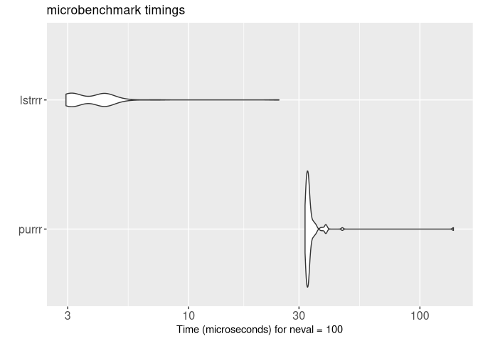
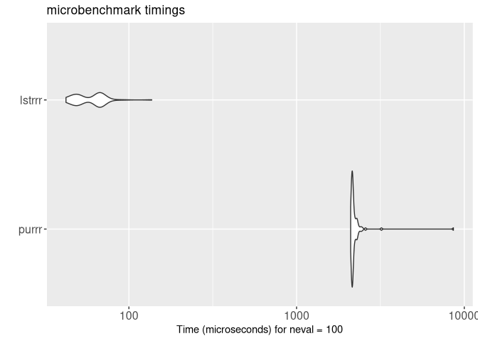
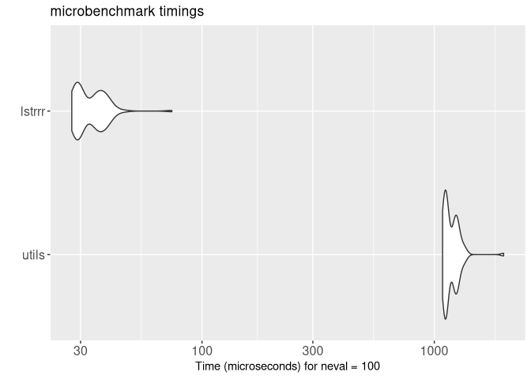

    library(lstrrr)
    data(sputnik_1)

## Map & Walk

Here, we will use a simple example to illustrate the performance
difference of `lstrrr`.

    files <- list.files(all.files = TRUE, recursive = TRUE)
    files_list <- dir_listwise(files)

    slow_string_op <- function(x, n = 10) {
      stopifnot(is.character(x))

      out <- x

      for (i in seq_len(n)) {
        out <- paste0(
          rev(strsplit(out, "", fixed = TRUE)[[1]]),
          collapse = ""
        )
        out <- toupper(out)
        out <- tolower(out)
      }

      out
    }

    set.seed(123)

    bench_map <- microbenchmark::microbenchmark(
      purrr_10 = {
        purrr::walk(files, \(x) slow_string_op(x))
      },
      lstrrr_10 = {
        list_walk(files_list, \(x) slow_string_op(x))
      },
      purrr_50 = {
        purrr::walk(files, \(x) slow_string_op(x, n = 50))
      },
      lstrrr_50 = {
        list_walk(files_list, \(x) slow_string_op(x, n = 50))
      },
      purrr_100 = {
        purrr::walk(files, \(x) slow_string_op(x, n = 100))
      },
      lstrrr_100 = {
        list_walk(files_list, \(x) slow_string_op(x, n = 100))
      }
    )
    print(bench_map)
    #> Unit: milliseconds
    #>        expr       min        lq      mean    median        uq        max neval
    #>    purrr_10  3.030297  3.091402  3.368821  3.112378  3.151750  15.287408   100
    #>   lstrrr_10  2.953515  2.996233  3.025710  3.024970  3.047822   3.143753   100
    #>    purrr_50 14.325471 14.485442 15.228383 14.598793 14.769506  27.229413   100
    #>   lstrrr_50 14.233452 14.372943 15.108003 14.494130 14.615348  27.183190   100
    #>   purrr_100 28.406875 28.751552 29.815807 28.959810 29.233874  41.509325   100
    #>  lstrrr_100 28.361244 28.641291 31.515401 28.832363 29.113798 232.888763   100

    ggplot2::autoplot(bench_map) +
      ggplot2::theme(axis.text = ggplot2::element_text(size = 12))

## Detect Depth

    set.seed(124)

    bench_depth <- microbenchmark::microbenchmark(
      purrr = {
        purrr::pluck_depth(sputnik_1)
      },
      lstrrr = {
        list_depth(sputnik_1)
      }
    )
    print(bench_depth)
    #> Unit: microseconds
    #>    expr      min       lq       mean    median       uq       max neval
    #>   purrr 7296.421 7419.271 7837.80179 7711.7020 7784.662 12437.158   100
    #>  lstrrr    4.046    4.935    7.86758    8.8935    9.759    17.014   100

    ggplot2::autoplot(bench_depth) +
      ggplot2::theme(axis.text = ggplot2::element_text(size = 12))

## Assignment

    set.seed(125)

    bench_assign <- microbenchmark::microbenchmark(
      purrr = {
        purrr::list_assign(sputnik_1, z = list(a = 1:5))
      },
      lstrrr = {
        list_set(sputnik_1, c("z"), list(a = 1:5))
      }
    )
    print(bench_assign)
    #> Unit: microseconds
    #>    expr    min     lq     mean  median      uq     max neval
    #>   purrr 31.869 32.361 34.53122 32.8930 33.6135 139.616   100
    #>  lstrrr  2.949  3.115  4.00796  3.8315  4.3260  24.577   100

    ggplot2::autoplot(bench_assign) +
      ggplot2::theme(axis.text = ggplot2::element_text(size = 12))

## Modification

    set.seed(126)

    bench_modify <- microbenchmark::microbenchmark(
      purrr = {
        purrr::list_modify(sputnik_1, test_branches = list(null_leaf = 1:5))
      },
      lstrrr = {
        list_set(sputnik_1, c("test_branches", "null_leaf"), 1:5)
      }
    )
    print(bench_modify)
    #> Unit: microseconds
    #>    expr    min     lq     mean median     uq     max neval
    #>   purrr 54.518 55.319 58.06257 55.824 56.913 175.739   100
    #>  lstrrr  2.663  2.873  3.67868  3.695  3.856  24.255   100

    ggplot2::autoplot(bench_modify) +
      ggplot2::theme(axis.text = ggplot2::element_text(size = 12))

## Flatten

    set.seed(127)

    bench_flatten <- microbenchmark::microbenchmark(
      purrr = {
        purrr::list_flatten(sputnik_1)
      },
      lstrrr = {
        list_flatten(sputnik_1)
      }
    )
    print(bench_flatten)
    #> Unit: microseconds
    #>    expr      min        lq       mean    median       uq      max neval
    #>   purrr 2101.440 2134.5865 2262.35417 2160.6170 2217.020 8619.089   100
    #>  lstrrr   42.156   48.9525   59.35466   64.0395   67.471  136.861   100

    ggplot2::autoplot(bench_flatten) +
      ggplot2::theme(axis.text = ggplot2::element_text(size = 12))

## modifyList

    set.seed(128)

    foo <- sputnik_1
    foo$test_branches$empty_branch$score <- 1e-256

    bench_modify_list <- microbenchmark::microbenchmark(
      utils = {
        utils::modifyList(sputnik_1, foo)
      },
      lstrrr = {
        modify_list(sputnik_1, foo)
      }
    )
    print(bench_modify_list)
    #> Unit: microseconds
    #>    expr      min        lq       mean   median        uq      max neval
    #>   utils 1085.775 1115.3865 1185.65383 1140.528 1240.3135 1988.749   100
    #>  lstrrr   27.497   29.1735   33.49651   31.573   37.2675   74.142   100

    ggplot2::autoplot(bench_modify_list) +
      ggplot2::theme(axis.text = ggplot2::element_text(size = 12))

