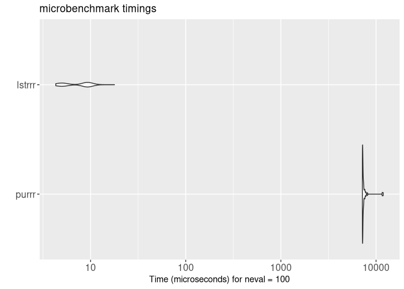
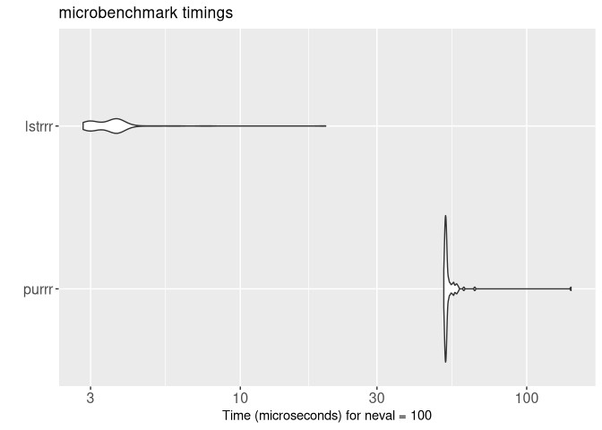
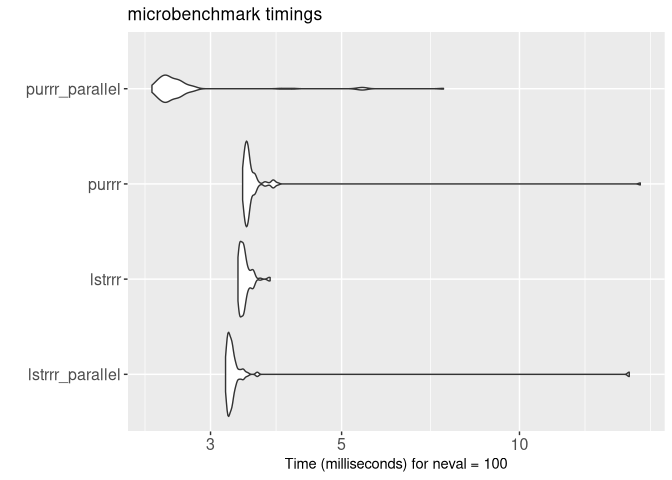

    library(lstrrr)
    data(sputnik_1)

## Map & Walk

Here, we will use a simple example to illustrate the performance
difference of `lstrrr`.

    files <- list.files(all.files = TRUE, recursive = TRUE)
    files_list <- dir_listwise(files)

    slow_string_op <- function(x, n = 10) {
      stopifnot(is.character(x))

      out <- x

      for (i in seq_len(n)) {
        out <- paste0(
          rev(strsplit(out, "", fixed = TRUE)[[1]]),
          collapse = ""
        )
        out <- toupper(out)
        out <- tolower(out)
      }

      out
    }

    set.seed(123)

    bench_map <- microbenchmark::microbenchmark(
      purrr_10 = {
        purrr::walk(files, \(x) slow_string_op(x))
      },
      lstrrr_10 = {
        list_walk(files_list, \(x) slow_string_op(x))
      },
      purrr_50 = {
        purrr::walk(files, \(x) slow_string_op(x, n = 50))
      },
      lstrrr_50 = {
        list_walk(files_list, \(x) slow_string_op(x, n = 50))
      },
      purrr_100 = {
        purrr::walk(files, \(x) slow_string_op(x, n = 100))
      },
      lstrrr_100 = {
        list_walk(files_list, \(x) slow_string_op(x, n = 100))
      }
    )
    print(bench_map)
    #> Unit: milliseconds
    #>        expr       min        lq      mean    median        uq       max neval
    #>    purrr_10  3.323728  3.364545  3.514765  3.396914  3.419538  14.14159   100
    #>   lstrrr_10  3.270054  3.308309  3.447193  3.336969  3.362311  13.85424   100
    #>    purrr_50 15.905605 16.017874 16.513380 16.186982 16.271546  27.86884   100
    #>   lstrrr_50 15.809607 15.935830 16.317077 16.117632 16.204460  27.21909   100
    #>   purrr_100 31.672615 31.906179 33.050140 32.276707 32.380160  43.15841   100
    #>  lstrrr_100 31.605593 31.772404 35.419516 32.160251 32.362977 236.18867   100

    ggplot2::autoplot(bench_map) +
      ggplot2::theme(axis.text = ggplot2::element_text(size = 12))

## Detect Depth

    set.seed(124)

    bench_depth <- microbenchmark::microbenchmark(
      purrr = {
        purrr::pluck_depth(sputnik_1)
      },
      lstrrr = {
        list_depth(sputnik_1)
      }
    )
    print(bench_depth)
    #> Unit: microseconds
    #>    expr      min        lq       mean    median       uq       max neval
    #>   purrr 7180.645 7216.0595 7500.97872 7242.6550 7387.149 11898.469   100
    #>  lstrrr    4.312    5.1105    7.56294    8.8075    9.353    17.828   100

    ggplot2::autoplot(bench_depth) +
      ggplot2::theme(axis.text = ggplot2::element_text(size = 12))

## Assignment

    set.seed(125)

    bench_assign <- microbenchmark::microbenchmark(
      purrr = {
        purrr::list_assign(sputnik_1, z = list(a = 1:5))
      },
      lstrrr = {
        list_set(sputnik_1, c("z"), list(a = 1:5))
      }
    )
    print(bench_assign)
    #> Unit: microseconds
    #>    expr    min      lq     mean  median      uq     max neval
    #>   purrr 29.915 30.2225 31.65427 30.4380 30.7360 111.328   100
    #>  lstrrr  3.081  3.1770  3.83690  3.6855  4.0135  20.415   100

    ggplot2::autoplot(bench_assign) +
      ggplot2::theme(axis.text = ggplot2::element_text(size = 12))

## Modification

    set.seed(126)

    bench_modify <- microbenchmark::microbenchmark(
      purrr = {
        purrr::list_modify(sputnik_1, test_branches = list(null_leaf = 1:5))
      },
      lstrrr = {
        list_set(sputnik_1, c("test_branches", "null_leaf"), 1:5)
      }
    )
    print(bench_modify)
    #> Unit: microseconds
    #>    expr    min      lq     mean  median     uq     max neval
    #>   purrr 51.351 51.9215 53.88568 52.2765 52.901 142.864   100
    #>  lstrrr  2.825  3.0080  3.67424  3.6195  3.726  19.871   100

    ggplot2::autoplot(bench_modify) +
      ggplot2::theme(axis.text = ggplot2::element_text(size = 12))

## Flatten

    set.seed(127)

    bench_flatten <- microbenchmark::microbenchmark(
      purrr = {
        purrr::list_flatten(sputnik_1)
      },
      lstrrr = {
        list_flatten(sputnik_1)
      }
    )
    print(bench_flatten)
    #> Unit: microseconds
    #>    expr      min        lq      mean    median       uq      max neval
    #>   purrr 1970.300 2002.4970 2085.5240 2073.8000 2143.013 2900.669   100
    #>  lstrrr   41.657   45.6975   55.1192   60.2365   62.323  105.663   100

    ggplot2::autoplot(bench_flatten) +
      ggplot2::theme(axis.text = ggplot2::element_text(size = 12))

## modifyList

    set.seed(128)

    foo <- sputnik_1
    foo$test_branches$empty_branch$score <- 1e-256

    bench_modify_list <- microbenchmark::microbenchmark(
      utils = {
        utils::modifyList(sputnik_1, foo)
      },
      lstrrr = {
        modify_list(sputnik_1, foo)
      }
    )
    print(bench_modify_list)
    #> Unit: microseconds
    #>    expr      min       lq       mean    median       uq      max neval
    #>   utils 1021.369 1030.055 1038.75312 1036.0830 1041.894 1128.324   100
    #>  lstrrr   27.765   29.108   32.30914   32.0745   34.568   64.743   100

    ggplot2::autoplot(bench_modify_list) +
      ggplot2::theme(axis.text = ggplot2::element_text(size = 12))

## Parallel Computation

Most of logic is in C implementation, so the acceleration is not that
obvious.

    set.seed(129)
    mirai::daemons(3L)
    crate <- purrr::in_parallel(
      \(x) {
        slow_string_op(x, n = 10)
      },
      slow_string_op = slow_string_op
    )
    fn <- function(x) {
      slow_string_op(x, n = 10)
    }

    bench_parallel <- microbenchmark::microbenchmark(
      lstrrr_parallel = {
        list_map(files_list, crate)
      },
      lstrrr = {
        list_map(files_list, fn)
      },
      purrr = {
        purrr::map(files, fn)
      },
      purrr_parallel = {
        purrr::map(files, crate)
      }
    )
    mirai::daemons(0L)
    print(bench_parallel)
    #> Unit: milliseconds
    #>             expr      min       lq     mean   median       uq       max neval
    #>  lstrrr_parallel 3.180860 3.214758 3.505192 3.246692 3.284975 15.338705   100
    #>           lstrrr 3.338676 3.366277 3.423986 3.405443 3.448899  3.784324   100
    #>            purrr 3.399585 3.437874 3.626854 3.468427 3.520160 16.012374   100
    #>   purrr_parallel 2.387677 2.493289 2.759666 2.551584 2.658171  7.437025   100

    ggplot2::autoplot(bench_parallel) +
      ggplot2::theme(axis.text = ggplot2::element_text(size = 12))

