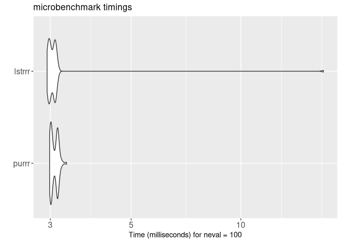

    library(lstrrr)

## Map & Walk

Here, we will use a simple example to illustrate the performance
difference of `lstrrr`.

    files <- list.files(all.files = TRUE, recursive = TRUE)
    files_list <- dir_listwise(files)

    slow_string_op <- function(x, n = 10) {
      stopifnot(is.character(x))

      out <- x

      for (i in seq_len(n)) {
        out <- paste0(
          rev(strsplit(out, "", fixed = TRUE)[[1]]),
          collapse = ""
        )
        out <- toupper(out)
        out <- tolower(out)
      }

      out
    }

    set.seed(123)

    bench_map <- microbenchmark::microbenchmark(
      purrr = {
        purrr::walk(files, \(x) slow_string_op(x))
      },
      lstrrr = {
        list_walk(files_list, \(x) slow_string_op(x))
      }
    )
    print(bench_map)
    #> Unit: milliseconds
    #>    expr      min       lq     mean   median       uq       max neval
    #>   purrr 2.987354 3.009674 3.079363 3.063402 3.141364  3.323898   100
    #>  lstrrr 2.939991 2.973108 3.171761 3.025581 3.091127 16.854858   100

    ggplot2::autoplot(bench_map) +
      ggplot2::theme(axis.text = ggplot2::element_text(size = 12))

I basically use C to implement the `map` like functions. However, the
progress bar implemented on the C side cannot faithfully reproduce the
progress bar from the `cli` package.

## Detect Depth

    set.seed(124)

    bench_depth <- microbenchmark::microbenchmark(
      purrr = {
        purrr::pluck_depth(sputnik_1)
      },
      lstrrr = {
        list_depth(sputnik_1)
      }
    )
    print(bench_depth)
    #> Unit: microseconds
    #>    expr      min       lq       mean    median       uq       max neval
    #>   purrr 7211.146 7259.725 7563.13417 7298.2635 7569.488 12156.007   100
    #>  lstrrr    4.101    4.871    7.40929    8.5975    9.328    17.065   100

    ggplot2::autoplot(bench_depth) +
      ggplot2::theme(axis.text = ggplot2::element_text(size = 12))

## Assignment

    set.seed(125)

    bench_assign <- microbenchmark::microbenchmark(
      purrr = {
        purrr::list_assign(sputnik_1, z = list(a = 1:5))
      },
      lstrrr = {
        list_set(sputnik_1, c("z"), list(a = 1:5))
      }
    )
    print(bench_assign)
    #> Unit: microseconds
    #>    expr    min      lq     mean median      uq     max neval
    #>   purrr 29.723 30.2075 31.72399 30.426 30.9415 109.790   100
    #>  lstrrr  2.951  3.0705  3.63453  3.618  3.7400  18.889   100

    ggplot2::autoplot(bench_assign) +
      ggplot2::theme(axis.text = ggplot2::element_text(size = 12))

## Modification

    set.seed(126)

    bench_modify <- microbenchmark::microbenchmark(
      purrr = {
        purrr::list_modify(sputnik_1, test_branches = list(null_leaf = 1:5))
      },
      lstrrr = {
        list_set(sputnik_1, c("test_branches", "null_leaf"), 1:5)
      }
    )
    print(bench_modify)
    #> Unit: microseconds
    #>    expr    min      lq     mean median      uq     max neval
    #>   purrr 51.567 52.0305 54.14667 52.428 53.2265 150.702   100
    #>  lstrrr  2.743  2.8625  3.45416  3.390  3.5315  19.962   100

    ggplot2::autoplot(bench_modify) +
      ggplot2::theme(axis.text = ggplot2::element_text(size = 12))

## Flatten

    set.seed(127)

    bench_flatten <- microbenchmark::microbenchmark(
      purrr = {
        purrr::list_flatten(sputnik_1)
      },
      lstrrr = {
        list_flatten(sputnik_1)
      }
    )
    print(bench_flatten)
    #> Unit: microseconds
    #>    expr      min       lq       mean   median       uq      max neval
    #>   purrr 1969.057 2010.741 2076.15503 2045.040 2136.417 2393.772   100
    #>  lstrrr   41.485   46.212   56.07211   61.771   64.064  116.909   100

    ggplot2::autoplot(bench_flatten) +
      ggplot2::theme(axis.text = ggplot2::element_text(size = 12))

## modifyList

    set.seed(128)

    foo <- sputnik_1
    foo$test_branches$empty_branch$score <- 1e-256

    bench_modify_list <- microbenchmark::microbenchmark(
      utils = {
        utils::modifyList(sputnik_1, foo)
      },
      lstrrr = {
        modify_list(sputnik_1, foo)
      }
    )
    print(bench_modify_list)
    #> Unit: microseconds
    #>    expr      min       lq       mean   median       uq      max neval
    #>   utils 1023.402 1030.880 1037.90338 1036.811 1040.970 1137.132   100
    #>  lstrrr   27.387   28.599   31.99275   30.040   34.233   65.551   100

    ggplot2::autoplot(bench_modify_list) +
      ggplot2::theme(axis.text = ggplot2::element_text(size = 12))

