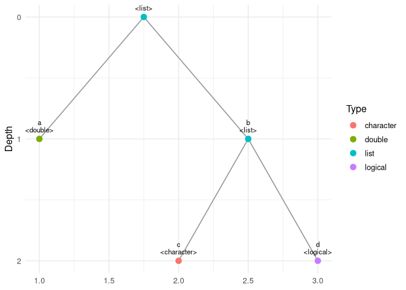
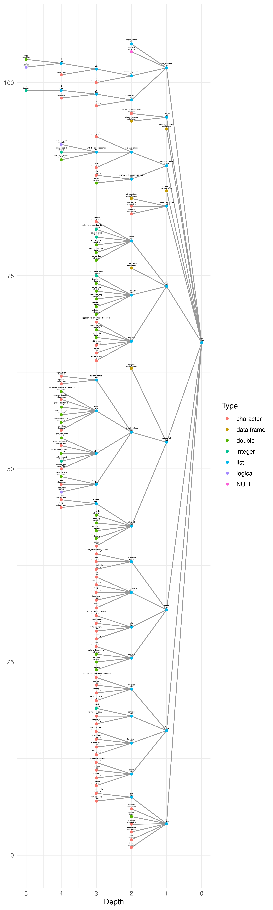

> This vignette shows the function utilities of `lstrrr`.

    library(lstrrr)

## TL;DR

<table>
<colgroup>
<col style="width: 30%" />
<col style="width: 69%" />
</colgroup>
<thead>
<tr>
<th>Function</th>
<th>Description</th>
</tr>
</thead>
<tbody>
<tr>
<td><code>list_stats(x)</code></td>
<td>Convert a nested list to tree data (nodes + edges)</td>
</tr>
<tr>
<td><code>viz_list(x)</code></td>
<td>Visualize list structure as a tree diagram</td>
</tr>
<tr>
<td><code>dir_listwise(paths)</code></td>
<td>Convert file paths to a nested list</td>
</tr>
<tr>
<td><code>modify_list(x, val)</code></td>
<td>Recursively merge two lists</td>
</tr>
</tbody>
</table>

## modify\_list

`modify_list` is similar to `utils::modifyList`. In most cases, we can
use `modify_list` to replace `utils::modifyList`.

    foo <- list(a = 1, b = list(c = "a", d = FALSE))
    bar <- list(e = 2, b = list(d = TRUE))

    v1 <- modify_list(foo, bar)
    str(v1)
    #> List of 3
    #>  $ a: num 1
    #>  $ b:List of 2
    #>   ..$ c: chr "a"
    #>   ..$ d: logi TRUE
    #>  $ e: num 2
    v2 <- utils::modifyList(foo, bar)
    str(v2)
    #> List of 3
    #>  $ a: num 1
    #>  $ b:List of 2
    #>   ..$ c: chr "a"
    #>   ..$ d: logi TRUE
    #>  $ e: num 2

    identical(v1, v2)
    #> [1] TRUE

The only difference is that `modify_list` keeps the unnamed elements.

    bar2 <- list(e = 2, b = list(d = TRUE), 3, data.frame())
    v3 <- modify_list(foo, bar2)
    str(v3)
    #> List of 5
    #>  $ a: num 1
    #>  $ b:List of 2
    #>   ..$ c: chr "a"
    #>   ..$ d: logi TRUE
    #>  $ e: num 2
    #>  $  : num 3
    #>  $  :'data.frame':   0 obs. of  0 variables
    v4 <- utils::modifyList(foo, bar2)
    str(v4)
    #> List of 3
    #>  $ a: num 1
    #>  $ b:List of 2
    #>   ..$ c: chr "a"
    #>   ..$ d: logi TRUE
    #>  $ e: num 2

    identical(v3, v4)
    #> [1] FALSE

## Make `list.files` Result into a List

    files <- list.files(".", recursive = TRUE, full.names = TRUE)
    head(files)
    #> [1] "./benchmark_with_purrr_files/figure-markdown_strict/viz_assign-1.png"     
    #> [2] "./benchmark_with_purrr_files/figure-markdown_strict/viz_depth-1.png"      
    #> [3] "./benchmark_with_purrr_files/figure-markdown_strict/viz_flatten-1.png"    
    #> [4] "./benchmark_with_purrr_files/figure-markdown_strict/viz_map-1.png"        
    #> [5] "./benchmark_with_purrr_files/figure-markdown_strict/viz_modify_list-1.png"
    #> [6] "./benchmark_with_purrr_files/figure-markdown_strict/viz_modify-1.png"

    files_list <- dir_listwise(files)
    cli::cli_alert_info("Class of files_list: {.cls {class(files_list)}}")
    #> ℹ Class of files_list: <list>

## Statistics for R list

`list_stats()` is a function to get the statistics of a list. The result
is a list containing 2 elements: `nodes` and `edges`.

    list_stats(foo)
    #> $nodes
    #>   id parent name      type     path depth is_leaf
    #> 1  1     NA root      list     root     0   FALSE
    #> 2  2      1    a    double   root.a     1    TRUE
    #> 3  3      1    b      list   root.b     1   FALSE
    #> 4  4      3    c character root.b.c     2    TRUE
    #> 5  5      3    d   logical root.b.d     2    TRUE
    #> 
    #> $edges
    #>   from to
    #> 1    1  2
    #> 2    1  3
    #> 3    3  4
    #> 4    3  5

## Visualize R list

`viz_list()` is a function to visualize a list. The result is a
`ggplot2` object.

    viz_list(foo)

It is useful to get a sense of the structure of a complex list.

    viz_list(sputnik_1, point_size = 1.5, text_size = 1L, line_width = 0.6) +
      ggplot2::coord_flip()

